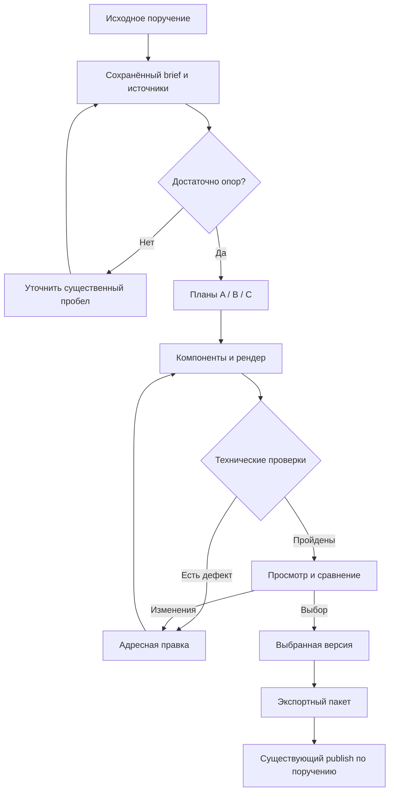

# Story Carousel — проект MCP и сохранённой истории

**Status: Draft / Not confirmed by user. Implementation: Not done.**
Дата проекта: 6 ноября 2026. Это каноническое место будущего контракта; предлагаемые команды ещё не являются доступными возможностями Vibe Publish.

Основание: [исследование и контрольный кейс](../../reports/story-carousel-research-2026-11-06.md), [реестр Slack-источников](../../reference/story-carousel/source-register.md). Тред требований в Slack используется только для чтения. Консультация Opus ожидается после передачи исследования владельцем.

## 1. Цель и граница первой версии

Владелец даёт естественное поручение в Slack: текст, голосовое, ссылки и фотографии. Агент превращает его в историю из 4–9 связанных карточек, сохраняет исходный смысл и источники, предлагает несколько разных решений, показывает результат, применяет адресные правки и подготавливает выбранную версию к существующему контуру публикации.

Первая вертикальная проверка: статичная история из 7 карточек 1080×1350, три варианта, реальные фотографии памятника, настоящий русский текст, общий холст 7560×1350, все шесть внутренних стыков запланированы. Работающий результат требует фактического рендера, просмотра и выбора владельца.

MVP не требует нового универсального графического редактора, собственного планировщика соцсетей, модели обучения на референсах или отдельного LLM-сервиса. Движущиеся и смешанные медиа, интерактивные редакторы и другие форматы добавляются после контрольного результата.

### Основные продуктовые инварианты

- Смысловой документ, конкретная сцена и экспорт различаются, но связаны версиями.
- Общий объект хранится один раз в глобальных координатах. Нарезка не создаёт независимые копии композиции.
- Значимый текст читается внутри отдельной карточки; общая плашка может пересекать границу.
- Документальное фото не деформируется и не дорисовывается без явного изменения задачи.
- A/B/C — варианты целой истории. Карточки 1…7 — последовательные части одного варианта.
- Любая публикационная выдача относится к конкретному выбранному варианту, его рендеру и проверкам.
- Неизвестный результат генерации восстанавливается чтением исходной операции. Новый ключ не используется как обход неизвестного исхода.
- Смысловая корректность и визуальная выразительность требуют редакционного просмотра; схема JSON этого не доказывает.
- Явное поручение владельца на выбранный результат сохраняется; система не добавляет повторные бессодержательные подтверждения.

## 2. Что существует сейчас, а что нужно добавить

### Срез источников

Код и документация прочитаны в main на commit **ba57554964fce4c88fb59cee69223a486e1b166a**. Live get_started проверен 6 ноября в 16:44 UTC: schema **1.12.0-runtime**, interface version **1.7.1-runtime-rkb-media-budget**, встроенный текст skill **1.7.1**. Это наблюдение контракта и объявленных возможностей, не новая проверка публикации в Telegram/VK.

Перед сохранением повторно прочитан main **06f37acfcd40326f3b38441ab34d7bdf93d9b99d**. Два новых commit относятся к MAX lazy album readback; исследованные shared visuals/compositor/contracts и изменяемые здесь docs index/routes не изменились. Документационный пакет основан на этой свежей вершине, а ссылки исходного аудита сохраняют точный изученный SHA.

Старые строки routes.yml о частичной поставке относятся к прежним этапам. Для проектирования используем точный исходный код и свежий ответ runtime; не делаем вывод о текущей неработоспособности по одному историческому маркеру.

| Есть в текущем источнике / контракте | Что это даёт | Чего это не доказывает |
| --- | --- | --- |
| [Shared visuals](../social-visuals/README.md), [VisualService](../../../social_operations/visuals.py) | Генерация/правка/композиция, приватные источники, сохранённые операции, candidate lineage, выбор через CAS | Наличие сохранённого документа карусели или произвольного общего scene graph |
| Ordered multi-photo tune, 2–8 исходников | Упорядоченный результат «одна обработка на фото», хеши источников и результатов | Это не A/B/C целых каруселей; существующий select выбирает один candidate, а не автоматически весь пакет |
| frame_source | Сохранение исходной фотографии и явный текст; overflow блокируется | Текущие режимы не являются свободным монтажом панорамы; ограничения исходного aspect/crop сохраняются |
| [SVG compositor](../../../social_operations/compositor.py) | Раздельные art/copy, проверка глифов, контуры букв, SHA шрифтов, SVG→PNG, recipe JSON | Сейчас один preset, фиксированные DejaVu-файлы и простой перенос; это не готовая система нескольких шрифтов, сложного shaping и межкарточных объектов |
| asset_preview, media_store, assets | Повторное использование проверенных приватных медиа и просмотр | Произвольный SVG клиента нельзя автоматически считать доверенным ассетом или разрешённой сценой |
| status и operation ledger | Состояния, воспроизводимые ответы, восстановление прежней работы | Нужна явная регистрация нового типа carousel-операций; существующий status не объявляется готовым к ним без изменения |
| [Social operations](../social-operations/README.md) / publish | Порядок медиа, права назначения, native scheduling, provider readback | Выбор карусели не равен поручению опубликовать; экспортный manifest ещё надо связать с публикационной моделью |

В частности, нельзя присвоить существующему single-candidate select смысл «утвердить все семь кадров». У новой сущности выбора должен быть свой целостный manifest.

Ещё одна граница: существующий выбор **inline visual может возобновить родительскую публикацию**. Поэтому carousel select не направляется механически в этот handler; он фиксирует выбор без публичного эффекта. Существующее surface=story обозначает платформенную сторис Telegram/VK, а не сохраняемую сущность StoryCarousel. Поддержка Instagram как назначения этим исследованием не подтверждена.

Обычный [asset preview](../social-operations/mcp-contract-v1.md) ограничен 768 px и 384 KiB. Full сохраняет оригинал лишь в пределах 2 MiB и 2560 px по длинной стороне, иначе применяет ограниченный JPEG. Поэтому длинное полотно в 50% требует отдельного render artifact и явного масштаба; обычный thumbnail не является проверкой читаемости.

## 3. Ответственность агента и сервера

| Работа | Агент | Сервер |
| --- | --- | --- |
| Понять естественное поручение | Извлекает тему, аудиторию, смысл, тон; задаёт вопрос только о существенной неопределённости | Сохраняет исходную ссылку и версию brief, права доступа |
| Проверить факты | Находит источники, различает факт/наблюдение/версию/позицию | Требует ссылки на evidence у factual claims; хранит происхождение, но не выдаёт наличие URL за истинность |
| Построить сюжет | Выбирает роль карточек, порядок, хук и завершение | Проверяет полноту структуры, ссылки и допустимые состояния |
| Предложить варианты | Формирует A/B/C и объясняет различия | Хранит планы, рецепты и неизменяемые версии; проверяет сохранение обязательных claim IDs и оговорок |
| Подготовить медиа | Выбирает кадрирование, области защиты, нужную компонентную генерацию | Проверяет существование, права, хеши, допустимые преобразования и бюджет |
| Собрать визуал | Предлагает layout в ограниченном языке сцены | Измеряет текст, выполняет shaping/маски/композицию/нарезку, создаёт воспроизводимые результаты |
| Оценить результат | Смотрит фактические картинки, читает текст, описывает дефекты и предпочтения | Выдаёт измерения, артефакты и диагностические коды; блокирует конкретные технические дефекты |
| Зафиксировать выбор | Интерпретирует действительное решение владельца | Привязывает decision к точной версии/рендеру и действующей авторизации |
| Опубликовать | Выполняет имеющееся поручение на выбранный результат | Использует существующие права, профиль площадки, immutable publication revision и provider readback |

Сервер не принимает клиентское «quality_passed: true» за результат своих проверок. Запись агента «я посмотрел» также не равна доказательству человеческого выбора. Отдельно хранятся machine report, editorial review и owner decision.

## 4. Модель данных

### 4.1. Story и редакционное ядро

**CarouselStory**: story_id, владелец/tenant, связь со Slack-тредом, название, текущая content revision, список вариантов и текущее решение.

**ContentRevision** — неизменяемый снимок:

- intent: исходное поручение, аудитория, главный вывод, тон, требуемое действие;
- ingress_refs: Slack permalink, source event ID, file IDs; доступ по действующим правам;
- transcript_ref и transcript revision для голосового, язык, сомнительные фрагменты;
- claims: ID, точная формулировка, тип, evidence refs, оговорки, verification status;
- sources: URL/документ, автор/дата если известны, проверенная часть, provenance;
- asset_refs: неизменяемые исходники, SHA, размеры, разрешённые изменения, права использования;
- copy: исходные и отредактированные строки, язык, роли, обязательные смысловые фрагменты;
- constraints: 4–9 карточек, выбранный формат, бренд, защищённые объекты, бюджет;
- caption и текстовые альтернативы: смысл всей истории вне растра.

Сервер хранит original intent отдельно от нормализованного brief. Исправление расшифровки не стирает прежнюю версию и может инвалидировать затронутые факты и макеты.

### 4.2. Варианты и сцена

**VariantRevision**: variant_id, variant_revision, content_revision, recipe_version, narrative plan, scene, font/palette refs, generation dependencies, output profile, digest.

**Card plan**: стабильный card_id, order_index, narrative_role, claim_ids, text_ids, media_refs, локальный смысл, входящая/исходящая связь.

**Scene**: canvas_width=N×card_width, canvas_height=card_height; список упорядоченных объектов; карточки — прямоугольные окна; все координаты в пикселях исходного холста. Индекс i начинается с нуля и заканчивается N−1.

Минимальные типы объектов:

| Тип | Поля |
| --- | --- |
| image | asset_ref, asset_sha256, bbox, crop/transform, opacity, mask_ref, protected_regions, source_integrity_policy |
| text | text_id, string digest, language, role, font_ref/hash, axes, size, line_height, bbox, no_break_spans, overflow_policy |
| panel | bbox, fill, radius, opacity, object span; текстовые ячейки отдельно |
| path | контрольные точки/сегменты, цвет, толщина, значение линии |
| group / mask | дочерние ID, ограниченная маска, transform, порядок слоя |
| viewport | card_id, x=i×card_width, y=0, width=card_width, height=card_height |

**Seam plan** для каждой внутренней границы: left/right card IDs, x coordinate, geometry bridge object IDs, narrative relation, защищённые области, ожидаемое продолжение. Семантический match cut или zoom не заменяет geometry bridge: их может сопровождать общая рамка/линия.

Для source_integrity_policy=preserve разрешены равномерное масштабирование, перенос и явно разрешённый поворот. Независимое изменение масштаба по осям, skew и перспективная деформация запрещены. Crop, mask и перекрывающие слои не могут скрывать защищённые области сверх согласованного правила. Генерация выполняется отдельным компонентом и монтируется только в разрешённой области. Сохранить исходные байты и сохранить корректное отображение источника — две разные проверки.

В первой версии не исполняем произвольный HTML/JS/SVG из модели. Агент передаёт валидированную декларативную сцену; сервер сам строит SVG из разрешённых примитивов и проверенных приватных изображений. Это продолжает существующее доверительное разграничение compositor.

### 4.3. Рендер, выбор и экспорт

**RenderResult**: render_id, точные content/variant revisions, scene digest, renderer version, font/asset hashes, previews, card assets, machine report, timestamps, lineage.

**Review**: review_id, render_id, кто и в каком качестве оценивал, какие представления действительно открыты, наблюдения, blocking issues, рекомендации. Owner decision хранится отдельной записью и ссылается на проверяемое поручение/событие, доступное текущему контексту авторизации. Сама переданная моделью цитата или user_id не повышает её полномочия.

**Selection**: story_id, content_revision, variant_revision, render_id, owner decision/ref, selection revision, manifest digest. Решения сохраняются append-only; active_selection меняется через CAS. Рекомендация агента может существовать до выбора, но не называется owner selection. Токен выбора привязан к конкретному render/candidate digest и действующим правам, а не служит сам по себе доказательством человеческого решения.

**ExportBundle**: bundle_id, selection ref, order 1…N, asset refs и SHA каждого файла, точные размеры/MIME, caption, alt/text equivalents, profile version, machine report digest, review refs, manifest hash.

Бинарные медиа и голосовые остаются в разрешённом runtime/media store, а не в публичном Git. Подписанные URL не являются устойчивыми идентификаторами.

## 5. Версии и адресные правки

Редакционное ядро и сцены версионируются отдельно:

- Изменение факта, обязательной оговорки или исходного текста создаёт новую ContentRevision и требует пересмотра всех зависимых вариантов.
- Сдвиг объекта или изменение размера заголовка создаёт новую VariantRevision выбранного варианта. Остальные варианты не перерисовываются без зависимости.
- Правка общей панели затрагивает все карточки, которые её пересекают.
- «Взять обложку из B для A» создаёт новую версию A с явной ссылкой на перенесённые объекты и проверкой новых соседних швов.
- Для изменённого выбранного результата прежний decision не переносится автоматически. Старые артефакты сохраняются для истории.
- Правка невыбранного независимого B не инвалидирует неизменённый выбранный A.
- Можно явно вернуться к старой версии, но это новый выбор конкретного сохранённого результата.

Сервер вправе повторно отрендерить всё полотно, если так проще и надёжнее. Пользовательский смысл «адресной правки» — отсутствие ручного восстановления всей истории и повторной дорогой генерации неизменённых компонентов.

Каждая мутация использует ожидаемые текущие revisions. Несовпадение возвращает revision_conflict и актуальный read ref; не применяется слепой last-write-wins.

## 6. Минимальная MCP-поверхность — предложение

Добавить **один доменный инструмент vibepublish_carousel** с discriminated command union. Это один discoverable вход, а не непрозрачный текстовый промпт. У каждой команды своя строгая схема входа/выхода. Читающие команды не требуют request_key; мутации требуют стабильный ключ.

| command.kind | Вход агента | Ответ / эффект |
| --- | --- | --- |
| create | Нормализованный brief, ingress refs, существующие asset/source refs, constraints | story_id, content_revision, missing information, allowed next actions; публичных эффектов нет |
| get | story_id и необязательные revisions | Снимок, варианты, операции, проверяемые refs; компактный summary по умолчанию |
| revise | story_id, expected revisions, адресный typed patch; в том числе сохранение 2–3 планов с recipe refs | Новые revisions/variant IDs, dependency invalidation и перечень требуемых проверок |
| render | variant refs, expected revisions, quality/profile, budget | operation_id, staged progress; затем RenderResult и previews |
| select | Точные content/variant/render refs, candidate digest и серверный choice token, expected selection revision, основание выбора | Selection для целой карусели; никакой автоматической публикации |
| export | Selection ref, target profile, expected revisions | Неизменяемый ExportBundle либо actionable blockers |

**Подготовка вариантов в MVP не скрывает ещё один LLM-оркестратор.** Агент приносит спроектированные варианты и сохраняет их через revise; сервер валидирует и сохраняет. Отдельная propose_variants не нужна, пока она повторяет эту операцию. Если позже планирование перенесётся внутрь сервиса, это отдельное решение с наблюдаемым вызовом, лимитом и происхождением результата. Render не переписывает принятое содержание: необходимая редактура возвращается как диагностика и проходит через новую revision.

Существующие visual generate/tune/compose могут создавать отдельные компоненты по обычному контракту. Carousel render собирает сцену из доступных компонентов. Не подменяем component generation независимой генерацией семи готовых карточек.

### Пример естественного поручения

> «Сделай семь карточек об этом памятнике. Используй эти три фото. Хочу передать ценность истории дружбы. Покажи спокойную документальную, более плакатную и архивную версии».

Агент сам строит структурированный create; если конкретная дата неизвестна, не заставляет пользователя придумывать её ради схемы. Существенная неизвестность сохраняется в claims и меняет формулировку рассказа.

### Иллюстративный create

Идентификаторы ниже условные; это образец будущего контракта, не вызов существующего инструмента.

```json
{
  "command": {
    "kind": "create",
    "intent": {
      "language": "ru",
      "audience": "читатели Полюбить Калининград",
      "takeaway": "Узнать имя памятника и границы подтверждённого знания",
      "tone": "спокойный, внимательный к истории",
      "call_to_action": "поделиться старой фотографией или воспоминанием"
    },
    "ingress_refs": [
      {"kind": "slack_thread", "ref": "authorized_thread_ref"}
    ],
    "asset_refs": ["asset_photo_1", "asset_photo_2", "asset_photo_3"],
    "constraints": {
      "card_count": 7,
      "card_size": [1080, 1350],
      "geometric_bridge_at_each_internal_seam": true,
      "source_geometry": "preserve",
      "variant_count": 3
    }
  },
  "request_key": "story-monument-create-v1"
}
```

### Иллюстративный receipt рендера

```json
{
  "operation_id": "op_carousel_render_illustrative",
  "status": "running",
  "story_id": "story_illustrative",
  "content_revision": 1,
  "variant_id": "A",
  "variant_revision": 2,
  "stage": "typeset",
  "completed_stages": ["freeze_inputs", "validate_assets"],
  "next_action": {"tool": "vibepublish_status", "operation_id": "op_carousel_render_illustrative"}
}
```

Совместимость status с новым типом должна быть реализована и проверена; пример не утверждает её сегодняшнюю готовность.

### Иллюстративный manifest после выбора

```json
{
  "bundle_id": "bundle_illustrative",
  "story_id": "story_illustrative",
  "content_revision": 1,
  "variant_id": "A",
  "variant_revision": 2,
  "render_id": "render_illustrative",
  "selection_id": "selection_illustrative",
  "count": 7,
  "card_size": [1080, 1350],
  "ordered_assets": [
    {"index": 1, "asset_ref": "asset_card_01", "sha256": "<actual hash at runtime>"},
    {"index": 2, "asset_ref": "asset_card_02", "sha256": "<actual hash at runtime>"}
  ],
  "example_note": "Для краткости показаны 2 из 7 записей; production manifest требует все 7",
  "caption_ref": "caption_revision_1",
  "profile_version": "profile_frozen_at_export",
  "manifest_sha256": "<actual hash at runtime>"
}
```

## 7. Состояния, восстановление и бюджет



Статус ресурса истории и статус операции — разные вещи. История может оставаться draft, пока рендер варианта B завершился успешно. Финальная публикация имеет собственные состояния существующего контура; слово rendered не означает published.

Общий ledger и worker используются повторно. Новые этапы: freeze_inputs → validate_assets → plan_layout → typeset → compose → slice → validate_export → preview_ready. Генеративные компоненты имеют собственные существующие job IDs и привязаны как зависимости.

Правила повторов:

- request_key привязан к actor, виду операции и digest входа; тот же ключ/вход возвращает прежний receipt, тот же ключ/другой вход — конфликт.
- При потере ответа агент читает operation_id или прежний ключ по предусмотренному контракту.
- Детерминированную сборку можно повторить с теми же замороженными входами; сохраняется связь попыток, не создаётся другая история.
- Неизвестный исход генерации не является основанием для нового submit. Используются существующие правила readback/reconciliation.
- Запоздалый результат не заменяет более новую выбранную версию.
- Отмена прекращает ещё не запущенные этапы и помечает running работу; уже созданные артефакты сохраняются по политике retention.
- Ошибка экспорта не требует повторного imagegen.

Бюджет задаётся до дорогой части: количество вариантов, максимум генеративных компонентов и повторных попыток, deadline, пиксельный/памятный предел композиции; денежный лимит — если стоимость доступна для достоверного учёта. Оценка стоимости явно отличается от фактической. После исчерпания бюджета возвращается частичный проверяемый результат и конкретная причина; бесконечного «улучшай до идеала» нет.

Исчерпание бюджета блокирует только этапы, которым нужен дополнительный ресурс. Готовый выбранный A можно экспортировать, даже если доработка C не завершилась. Если дополнительного ресурса требует сам экспорт, отказ относится к этой конкретной операции.

## 8. Renderer: минимальный путь расширения

Базовая рекомендация: расширить существующий доверенный SVG→PNG контур отдельным carousel preset/scene compiler, сохранив существующие single-image режимы. Наличие CairoSVG и fontTools в коде — полезная опора. Нужда в другом движке должна быть доказана конкретным ограничением, а не желанием переписать всё.

Нужно добавить:

1. Общий холст и стабильные объекты, маски/панели/линии, несколько приватных изображений.
2. Типографические роли и реестр закреплённых шрифтов вместо единственной фиксированной пары DejaVu.
3. Измерение действительного набора: глифы, advance, kerning/shaping, baseline, ink bounds и ограничения переносов. Текущее суммирование hmtx и разбиение по пробелам нельзя объявить полноценным Unicode shaping.
4. Точное размещение векторного текста, затем один растровый master и целочисленная нарезка.
5. Полотно, contact sheet, phone previews и seam pairs из одного RenderResult.
6. Manifest и проверка того, что склейка lossless-карточек воспроизводит соответствующие пиксели master.

Для MVP достаточно статичного PNG master. Если площадка требует иной формат или сжатие, исходный master остаётся lossless, а отдельная delivery derivative фиксирует параметры. Иначе проверка пиксельной идентичности смешается с потерями JPEG.

Локальные эффекты, тени и размытия вычисляются на общем холсте до нарезки. Если ради памяти появится tiled render, нужны одинаковые мировые координаты и overlap под фильтры, затем обрезка до точных окон. Нельзя независимо считать blur у каждого края и ожидать идентичного стыка.

Рецепты и font registry версионируются. Выбор библиотек shaping и окончательная граница scene compiler — вопрос консультации и короткого технического прототипа; никакой новый движок в этом документе не объявлен установленным.

## 9. Проверки качества

### 9.1. Что блокирует готовый экспорт

| Код / проверка | Основание отказа |
| --- | --- |
| source_missing / source_changed | Нет разрешённого ассета, нарушен hash или право доступа |
| claim_evidence_missing | Обязательный factual claim не имеет разрешённой evidence ref либо нарушена связь claim → copy → source |
| font_missing / glyph_missing / font_fallback | Нужного файла/символа нет или фактически использована неожиданная гарнитура |
| text_overflow / text_clipped | Потерян значимый текст, обязательная оговорка или штрих из-за границ/маски |
| viewport_invalid | Неверное число/размеры/координаты карточек, остаточная полоса или пустой экспорт |
| seam_geometry_invalid | Общий объект раскололся из-за разных трансформаций; не выполнен заявленный bridge |
| protected_region_cut | Незаявленная обрезка защищённого лица, надписи или ключевой детали |
| source_transform_invalid / protected_region_changed | При preserve применено неравномерное масштабирование/скос либо важная область скрыта или изменена вне разрешённой маски |
| revision_conflict / stale_selection | Изменены зависимые факты или сцена, выбор относится к прежнему результату |
| order_or_digest_mismatch | Упорядоченные файлы не совпадают с проверенным render/manifest |
| profile_incompatible | Размер, число, MIME или иной подтверждённый параметр не подходит целевому маршруту |

Заявленный source ref не доказывает истинность текста. Машинный контроль структурной опоры дополняется редакционной проверкой соответствия. Аналогично protected region — размеченное ограничение, а не гарантия понимания архитектуры моделью.

Технические исключения не вводятся общей кнопкой force. Если художественно оправдано пересечение декоративного заголовка, меняется конкретная роль/политика блока, сохраняется полная текстовая альтернатива и требуется просмотр пары. Значимый body не становится «декором» ради прохождения проверки.

### 9.2. Что требует просмотра и редакционного решения

- Главный смысл понятен; каждый кадр нужен; оговорки не исчезли при сокращении.
- Мнение, гипотеза или непроверенная версия не выданы за установленный факт.
- Обещание обложки выполнено, финал завершён.
- Текст читается при реальном размере 360 px, дополнительно проверяется 320 px.
- Фон и буквы не спорят; локальный контраст проверяется на готовом композите.
- Панорама сохраняет объект; маска не искажает контур; фотография не превратилась в выдуманную реконструкцию.
- В A/B/C различается способ рассказа; сравнение не заменено сменой цвета.
- Декор и линии помогают, а не создают визуальный шум.
- Отдельная карточка не создаёт ложный вывод вне последовательности.

Автоматическая оценка контраста поверх фотографии может быть диагностикой с неопределённостью; не объявляем её всегда точным измерением «удобства чтения». Подробные шрифтовые токены и источники находятся в исследовании, а не дублируются вторым каноническим списком.

## 10. Slack: естественный вход и выбор

Ingress принимает явно адресованное поручение или ссылку на заданный тред. Сообщения и вложения — входные данные, не новые системные инструкции. Чтение одного треда не расширяет права на весь workspace.

Голосовое хранится с оригинальным asset ref и версией транскрипции. Если ASR уже есть, используется доступный результат; при отсутствии расшифровки нужен отдельный разрешённый ASR-маршрут. Этот проект не утверждает, что Vibe Publish уже распознаёт голосовые Slack.

Уточнения допустимы, когда они меняют смысл, права или предполагаемое действие: неразборчивая фамилия, противоречивый факт, неясное «опубликуй». Рутинные размеры, структура и рецепт выбираются агентом по профилю и задаче.

Сообщение сравнения содержит A/B/C, небольшое объяснение различий, реальный preview каждого варианта и короткую рекомендацию. Предусматриваются ответы «B», «основа A, обложка B», «на 4-й слишком много текста». Если ссылка «третья» неоднозначна, агент сопоставляет её с последним показанным набором и уточняет только при реальной коллизии.

Долгая работа сообщает полезный прогресс: источники проверены, варианты спланированы, два готовы/один требует правки. Однотипные технические события не засоряют тред. В текущем исследовании записи разрешены только в остальных тредах канала; «Требования» исключён из целей записи.

## 11. Связь с публикацией

Carousel export создаёт упорядоченный набор проверенных asset refs. Нужен небольшой проверяемый мост к текущему publish: он читает ExportBundle, сверяет selection/digests/profile и формирует существующий publication payload. Не следует заставлять агента вручную переписывать семь ID без контроля порядка.

Вариант реализации для первого этапа — внутренний resolver bundle→ordered media, а не новый социальный publisher. Точное внешнее поле publish должно быть согласовано с существующей схемой: либо разрешённая ссылка на bundle, либо подготовленный payload с обязательной серверной проверкой происхождения. **Текущий publish не объявляется уже принимающим bundle_id.**

При создании публикации фиксируются ExportBundle, selection receipt и авторизация для этой immutable publication revision. Последующие правки истории или смена active_selection не изменяют и не отменяют её автоматически. Замена/отмена выполняются отдельной существующей publication operation. Проверка stale_selection применяется при создании нового экспортного или публикационного решения, а не как скрытая отмена уже принятого задания.

Перед эффектом повторно проверяются действующие destination binding/rights и совместимость замороженного пакета с площадкой. Снимок профильных ограничений нужен для воспроизводимости, но не заменяет проверку актуальной возможности публикации. Порядок и выбранная версия берутся из принятой publication revision, а не из изменяемого active_selection.

Назначенное время передаётся существующему provider-native scheduling. Не добавляем местный планировщик публикаций. Accepted не равно verified; применяются текущие provider readback и правила частичного успеха по площадкам. Успех в Telegram не превращает ошибку VK в общий успех или повод дублировать Telegram.

Preview может показать ожидаемое представление, но реальные обрезки и поведение альбома проверяются в native-интерфейсе при приёмке. Особенно важно не приравнивать Telegram/VK album к интерфейсу Instagram swipe.

## 12. Расположение в репозитории и runtime

| Место | Содержание |
| --- | --- |
| docs/features/story-carousel/README.md | Этот draft-контракт, статусы, инварианты, приёмка |
| docs/reports/story-carousel-research-2026-11-06.md | Основное исследование, типографика, кейс, Opus brief |
| docs/reference/story-carousel/ | Каталог источников и авторские поясняющие схемы |
| Будущий versioned recipe registry | Параметры A/B/C, палитры, шрифтовые роли, разрешённые примитивы |
| Будущий carousel service/compiler | Узкий слой домена и сборки поверх имеющегося runtime |
| Существующий operation/media storage | Реальные stories/revisions/jobs/assets и receipts; с необходимой схемной миграцией |

Не добавляем конкретные несуществующие runtime-файлы в routes как реализованные entrypoints. Небольшие фикстуры для геометрии и текста могут находиться в тестах, но пользовательские фото, сырой Slack, подписанные ссылки и рабочие логи не коммитятся.

Серверные интеграции при реализации должны соблюдать действующий repository same-host standard и права principal. Этот проект не меняет OAuth, tenant isolation или owner gates.

## 13. Приёмочные сценарии реализации

Ниже будущие проверяемые требования, не отчёт о пройденных тестах. Тестирование выполняется на конкретной реализации и реальном контрольном кейсе.

| Сценарий | Ожидаемый результат |
| --- | --- |
| Семь карточек, общий объект на двух стыках | Ровно 7 файлов нужного размера; последовательная склейка lossless-файлов совпадает с master; важная область сохранена |
| Длинная русская строка с Ё/Й/№ и именем | Нет fallback, обрезанных диакритик и скрытого уменьшения; переполнение даёт понятную правку |
| Общая панель со скруглением | Скруглены внешние углы панели; на внутренних границах нет ложных округлых разрывов |
| A/B/C на одних фактах | Отличается минимум два заявленных аспекта; все обязательные claims и оговорки сохранены |
| Правка заголовка выбранного A | Новая variant revision, старый export не подставляется автоматически; неизменённые источники не генерируются заново |
| Правка независимого B | Выбранный неизменённый A остаётся валидным |
| Выбор B после постановки A в native-очередь | Публикация A сохраняет свой пакет; её изменение требует отдельного поручения и штатной update/cancel операции |
| Изменение даты в расшифровке | Новая content revision, затронутые варианты требуют пересмотра |
| Два клиента правят одну версию | Второй получает revision_conflict, первая правка не теряется |
| Потерян ответ render | Повтор с тем же ключом возвращает ту же операцию и результат |
| Неизвестный исход imagegen | Нет второго submit; применяется существующее восстановление наблюдения |
| Перезапуск worker после compose | Продолжение по сохранённым receipts; нет новой истории и дубля генерации |
| Экспорт до выбора или после устаревшей правки | Отказ с точной причиной и следующим действием |
| Публикация из bundle | Точный порядок, хеши и выбранная версия; штатная авторизация и provider readback |
| Проверка телефона и native-альбома | Текст читается, порядок и показ соответствуют ожиданию; выявленные ограничения отмечены |
| Исчерпан бюджет | Частичный результат сохраняется; готовый выбранный вариант доступен для экспорта; нет бесконечных повторов |
| Чужой tenant/отозванный доступ | Чтение/мутация/экспорт закрыты действующими правилами, без обхода |

## 14. Решения для Opus и первый прототип

Открытые решения: минимальный набор команд; граница ContentRevision/VariantRevision; путь shaping и scene compiler; достоверное связывание пользовательского выбора с сессией; способ передачи bundle в publish; какие проверки действительно блокируют экспорт; первый профиль native-отображения.

Рекомендуемый прототип: **один реальный brief → три декларативных плана → три статичных рендера → выбор → одна адресная правка → семь экспортных карточек**. Генерация новых изображений на первом прогоне необязательна. Это проверяет главный пользовательский цикл и не требует сразу строить универсальную систему.

Полный список вопросов и контекст для консультации — в основном исследовании. До консультации и выбора владельца статус остаётся Draft / Not confirmed by user; ни код, ни успешный рендер сами по себе не означают Done.

