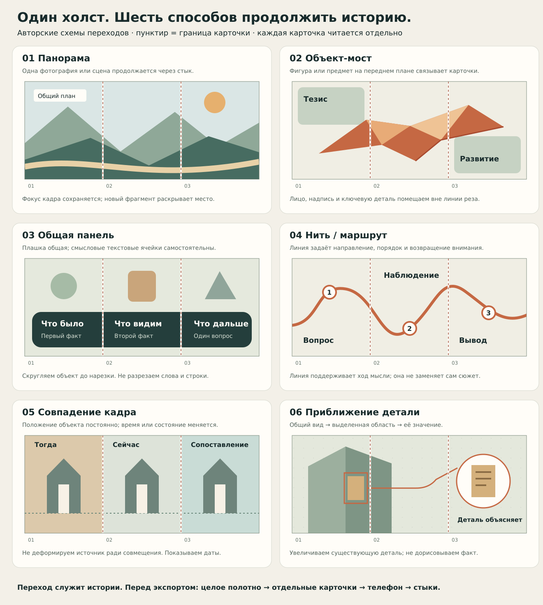

# 30 · Швы и мосты

## Язык связности из примеров E01–E23 (главное, смотри картинки через get(scope:reference))

Связность в сильных каруселях делают **выразительные элементы**, а не аккуратная геометрия. Перед скетчем открой подходящие реальные примеры ниже и осмысленно перенеси видимые приёмы.

| ID | Приём | Как выглядит в примерах | Где (E) | Как сделать у нас |
|---|---|---|---|---|
| L01 | **Герой-вырезка через стык** | человек/предмет без фона, крупно, ч/б или тонирован + акцентный цвет, заходит на соседнюю карточку на 30–60 % | E03, E11, E12, E13, E15, E16 | генерация/обработка объекта (60-gen §2) → вырезка F4 или на фоне зоны; объект ставить ПОВЕРХ стыка |
| L02 | **Один герой в разных позах по всей ленте** | бегущий/дерущиеся/один персонаж повторяется на 3–7 карточках, каждый раз через стык | E11, E12, E16 | серия генераций одного героя по образцу (85 §2): «тот же человек, новая поза…» |
| L03 | **Лицо/фигура, разрезанные стыком** | половина лица на одной карточке, половина на другой, глаза совпадают | E13, E14, E15 | крупный портрет/объект центром ровно на шве; проверить пару |
| L04 | **Рисованные дудлы** | петли, завитки, стрелки от руки, пунктирные извилистые линии через 2–4 карточки, подчёркивания, кружки, звёздочки | E13, E14, E15, E16 | генеративный дудл-слой (F2 на фоне зоны или F4) или SVG path с неровным штрихом 6–12 px |
| L05 | **Крупная стрелка через стык** | жирная стрелка 300–700 px, указывает на продолжение | E10, E22 | SVG или генеративная; одна-две на историю |
| L06 | **Комиксный пузырь/реплика** | пузырь с текстом, хвост к герою, иногда на стыке | E14, E21 | SVG path пузыря + текст / генеративный леттеринг в пузыре |
| L07 | **Огромный кегль + акцентное слово** | 3–6 слов узким жирным, 1–2 слова акцентным цветом; номера 01–06 гигантские | E11–E16, E22 | генеративный леттеринг (40-typography) или Oswald/Bebas; цифры — Display |
| L08 | **Текст, разрезанный стыком** | слово по слогам через карточки (SIM-PLI-CI-TY), вертикальная надпись вдоль стыка | E18, E17 | крупное слово через шов; вертикальный текст rotate(-90) у реза |
| L09 | **Коллаж фото вне сетки** | фото разных масштабов внахлёст, через стыки, повороты 2–6°, полароид/скотч, рваная бумага | E01, E04, E06, E07, E18, E21 | маски/скругления, рамки-полароиды, тени; кадр через стык |
| L10 | **Огромная органическая форма** | капля/капсула/дуга цвета акцента через 2–3 карточки, внутри текст и фото | E02, E19, E20 | SVG path крупно + маски фото внутри |
| L11 | **Гигантское фоновое слово** | слово темы 400–700 px, 6–15 % непрозрачности, через несколько карточек | E19, E23, E17 | 70-montage §7 |
| L12 | **Предмет-метафора стикером** | 3D-объект (ракета, сердце, лампа, мегафон, камера, фотоаппарат) на стыке или рядом | E22, E23 | генерация 3D-объекта в стиле паспорта на фоне зоны / вырезка |
| L13 | **Цветовой блок, наползающий на фото** | акцентный прямоугольник/полоса поверх части фото, текст на нём | E03, E22, E23 | rect с акцентом + скрим |
| L14 | **Мокап интерфейса** | телефон, плашки чата/кнопок, лайки | E21, E23 | генерация мокапа / SVG плашки |
| L15 | **Одна сильная акцентная краска** | фиолетовый/оранжевый/красный на ч/б фото через всю ленту | E10–E16, E22, E23 | палитра: 1 акцент + монохром фото (70-montage §6 duo) |

## Правило выбора

- Ведущий приём связности — **L01/L02/L03 (герой через стык)** или **L09/L10 (коллаж/форма)**, если в истории есть герой или много фото; **L07/L08/L11** — если история типографическая.
- Поддерживающие «живые» слои — **L04 дудлы**, **L05 стрелка**, **L06 пузырь**, **L12 предмет-метафора** — добавляй там, где они помогают рассказу.
- Проектируй много предметных связей по ленте: герой, лицо, фото, коллаж, форма или выразительная надпись продолжают рассказ между карточками. Место и число переходов определяет композиция, без квоты каждого или большинства швов. Тонкая линия и «язычок» панели могут помогать, но не заменяют предметное продолжение.
- Плотность как в примерах: на карточке крупный заголовок + крупный визуал; пустые аккуратные поля с маленькой фотографией — анти-образец.

## Анти-образцы (так было у нас — не делать)

- Ровные прямоугольные фото одинакового размера на бумажном фоне с полями.
- «Язычки» панелей, заходящие на 80–200 px, и тонкая линия как единственная связь.
- Скромные заголовки 80–110 px на пустом поле.
- Отсутствие героя, дудлов, стрелок, предметов, коллажа.

## Вспомогательные мосты (геометрия, вторичны)

Словарь ниже — варианты геометрии для выбранной композиции, не требование моста на каждом шве, механического чередования или фиксированного числа типов.

| ID | Мост | Геометрия | Когда |
|---|---|---|---|
| S01 | Фото через шов | перекрытие 140–420 px, без разреза лица/текста | общий план, панорама |
| S02 | Объект-вырезка через шов | силуэт 30–60 % на каждой стороне, единая тень | герой/памятник |
| S03 | Общая панель | скруглённая панель r 40–80 px, заходит 200–500 px | тезисы, даты |
| S04 | Цветная зона «язык» | блок соседнего цвета заходит 80–200 px, скругление со стороны входа | смена главы |
| S05 | Крупное слово через шов | слово ≥ 220 px, разрез между буквами, не по середине буквы | лозунг, имя |
| S06 | Нить/таймлайн | линия на одной высоте через все швы, узлы у событий | время, маршрут |
| S07 | Рисованная петля | от руки, 6–10 px, завиток пересекает шов | живой тон |
| S08 | Стрелка-жест | одна стрелка на историю, от вопроса к ответу | поворот |
| S09 | Пузырь реплики | хвост на одной карточке, пузырь на другой | цитата |
| S10 | Рваная бумага | кромка шириной 40–80 px вдоль шва, бумага уходит на соседа | архив, досье |
| S11 | Градиент фона | фон сегмента плавно переходит в цвет следующего на 300–600 px | смена настроения |
| S12 | Общая подложка-сегмент | общая среда на 2, 3 или 4 карточки; подробность подчинена герою | среда истории |
| S13 | Стопка кадров | снимок частично под соседним, тень 0/12/24 px 25 % | коллаж |
| S14 | Иконка-мост | иконка 120–200 px пересекает шов | приём, метафора |
| S15 | Число через шов | крупная цифра, разрез между знаками | метрика |
| S16 | Линия горизонта | горизонт фото продолжается графикой | место |
| S17 | Тень объекта | объект на одной, его тень на другой | драматургия |
| S18 | Рамка-разворот | общая рамка/паспарту на 2 карточки | альбом |
| S19 | Повтор героя | тот же объект разной крупности по краям соседних | серия |
| S20 | Указатель-выноска | выноска от детали ведёт к подписи на соседней | аннотация |
| S21 | Узор/паттерн | сквозной орнамент полосой 60–120 px | тема, бренд |
| S22 | Фоновое слово | бренд/тема 6–12 % через 2–3 карточки | тихая связь |
| S23 | Маска сложной формы | одна органическая маска на 2 карточки, внутри два фото | редакционно |
| S24 | Намеренная остановка | сознательный «стоп» перед финалом (только 1 раз, перед CTA) | пауза |

**Проверка шва:** `render(view:region, region:[N*1080-300, 0, 600, 1350])` для каждого N = 1…N-1. Признаки брака: сдвиг контура/горизонта ≥ 2 px, разный масштаб объекта по сторонам, текст в полосе ±96 px, полоса фона другого оттенка (ΔE > 3), случайная «стрелка» из двух краёв.

## Правила применения шва

**Лицо и фигура.** Намеренный разрез допустим. Смотреть отдельное окно, пару, промежуточное окно и профиль площадки. Для портретной идентификации и документальной детали важно, что остаётся узнаваемым и что подтверждает изображение. Не вводить общий запрет по слову Telegram/VK.

**Текст.** Допустимы локальная фраза, заголовок через окна и буквенный слой как образ. Выбирать по обещанному способу чтения. Перенос по пробелу часто помогает, но не является универсальным запретом резать букву. Локальная опора должна позволять понять предмет; весь рассказ на каждой карточке не повторяется. Подпись поста дополняет доступность, но не исправляет плохую компоновку самой карточки.

**Фон.** Различать единый цвет, структурную зону, панораму и фактуру. Продолжающаяся зона может быть главным мостом. Не добавлять стрелку только ради формального наличия мостов. Положение границы по отношению к резу проверяется глазами; 60 px и 0,3W не доказанные нормы.

**Финал.** Повтор мотива может закрывать историю. Случайный peek/стрелка не должен обещать несуществующую карточку. Бренд хотя бы один раз; постоянная рамка опциональна и может исчезнуть на крупном фото, если авторство истории остаётся понятным.

## Мотив, повествование и короткий просмотр

| История | Полезный сквозной мотив | Почему / оговорка |
| --- | --- | --- |
| Место и его деталь | Панорама, контур, фотоокна | Зритель ориентируется в одном пространстве |
| Было / стало | Повтор ракурса, рамка, дата | Сравнение должно быть честным по точке зрения и источникам |
| Человек в действии | Герой, жест, след движения | Не заставляет генерировать нового персонажа для каждого окна |
| Объяснение / аргумент | Общая панель, линия, типографический ритм | Связывает тезисы без случайного фото |
| Дневник / временная история | Главы-даты, носитель фото, повтор детали | Время различимо, но не имитирует доказанную причинность |
| Сильная авторская позиция | Повтор ключевого слова, цитата, возвращение фото | Эмоциональная выразительность сохраняет авторство мнения |

**Общая композиция и разнообразие (уточнения владельца 08.11).** Карточки — окна общего рассказа: среда может охватывать весь холст или группы по 2, 3 или 4 окна. Однотонные участки допустимы, но не должны становиться единственным решением всего ряда и всех каруселей. Генерируй нужные компоненты, связывай карточки предметными изображениями и поддерживающими приёмами. Фон выделяет героя, а не отвлекает от него; короткие пояснения сохраняют повествование. Связность оценивается по видимой композиции, а не по числу пересечённых швов.

Для скетча: Q01, Q03, Q14, Q29; для монтажа: Q12, Q23, Q30, Q31; для финала: Q08, Q13, Q33 и вопрос об изменённом участке. Это стартовая подборка из существующего банка, не новые 12 обязательных согласований. Вместе с референсом Vibe возвращает «что здесь переносим» (например, один общий радиус/масштаб), «что не переносим» (сюжет/плотность/чужое фото), нужную пару и одно наблюдаемое различие. Эффект на охват и «остановку пальца за секунду» этим просмотром не измеряется.

[Палитры и типографические направления](50-palettes.md) · [Канонический MCP-процесс](../../features/story-carousel/README.md) · [Итог консультации](../../reports/story-carousel-reconciliation-2026-11-06.md).
