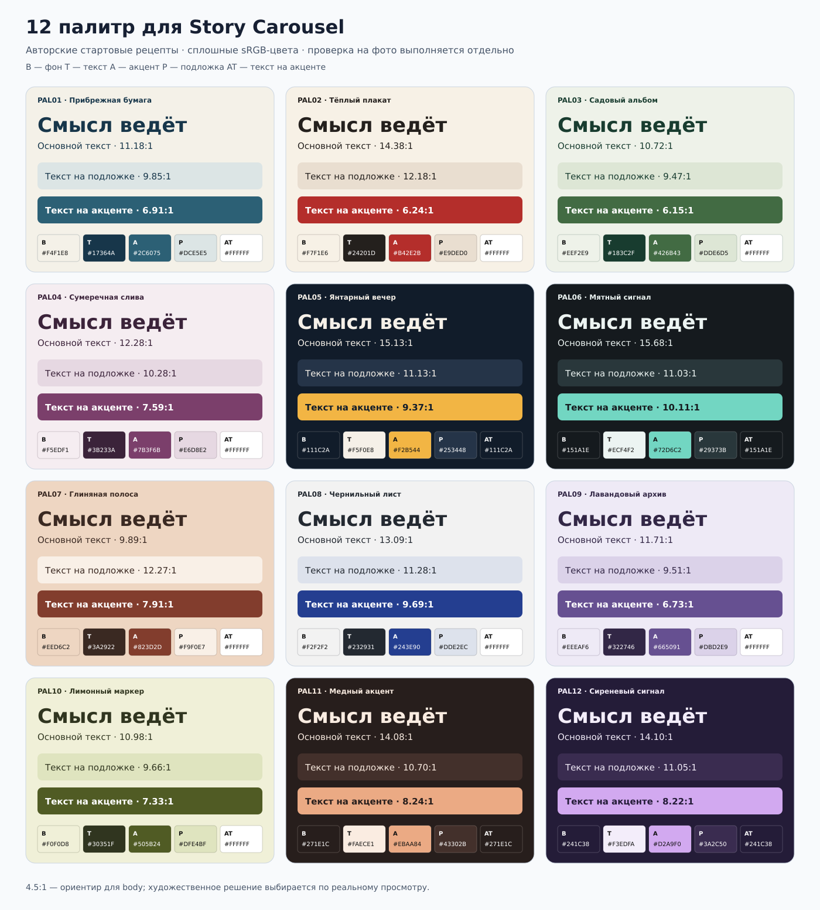

# 50 · Палитры



## Как строить палитру истории (процедура)

1. Сними 5–7 доминирующих цветов с главных фото (k-means по пикселям, без пересвеченных/чёрных); возьми 1 «фото-цвет» как основу фона или акцента.
2. Назначь роли B/T/A/P/AT. Фон — спокойный (насыщенность ≤ 25 % для светлых, ≤ 40 % для тёмных). Акцент — 1, насыщенный, контраст к фону ≥ 3:1. Второй акцент допустим только для разных ролей (например, даты).
3. Проверь контраст: Body к фону ≥ 4.5:1, крупный текст ≥ 3:1, AT на A ≥ 4.5:1.
4. Тёмная/светлая логика держится на всей истории; инверсия допустима на 1–2 карточках (пауза, CTA) — как смена главы.
5. Для фото разных цветовых температур — единая цветокоррекция (70-montage §6).

## Тематические опоры (стартовые, адаптируй)

| Тема | Основа | Акцент | Комментарий |
|---|---|---|---|
| Советский модернизм, бетон | `#E9E6DF` бетон, текст `#1F1F1F` | `#C8102E` красный | плакатный контраст, мало цвета |
| Польская тема | `#F4F1EA` | `#DC143C` + серебро `#BFC3C7` | бело-красная пара, орёл бледно |
| Архив, дневник | `#EFE6D2` бумага | `#7A3B2E` сургуч | PT Serif, рваная бумага |
| Море, Балтика | `#E7EEF0` | `#1F5A73` | холод, нить-волна |
| Ночь, свет | `#101820` | `#F2B544` | metric hero, неон-леттеринг |
| Природа, парк | `#EEF2E9` | `#426B43` | органические маски |

Бренд «Полюбить Калининград»: использовать текстом фоновым словом (S22) в цвете фона ±8 % светлоты; отдельной фирменной палитры нет — палитра от истории.


## Роли и применение


**Приоритет — палитра конкретной истории.** Модель начинает с цветов/света реальных фотографий, темы, авторской интонации и бренда; распределяет роли, проверяет соседство, считает предложенные пары стандартным инструментом. Таблица ниже — 12 примеров и отправных точек, не каталог «на все случаи» и не обязательный шаг выбора пресета. Извлечённый доминирующий цвет фотографии тоже не обязан становиться фоном: выбор остаётся композиционным.

- **B / bg:** основной фон. **T / text:** основной текст. **A / accent:** цветовой акцент, плашка или выделенная надпись. **P / panel:** спокойная подложка. **AT / on-accent:** текст на акцентной плашке.
- Каждый рецепт содержит 4–5 уникальных цветов: AT иногда совпадает с B. Роли важнее буквального повторения HEX во всей истории; модель может адаптировать набор и заново оценить соседство.
- Сначала примеряем 2–3 подходящих набора на **реальном crop фотографии, заголовке и соседних карточках**, затем выбираем. Полоски цветов не доказывают качество готовой композиции.
- Для основного текста используем **4.5:1 как reference**; это не автоматический запрет художественного заголовка или выбора владельца. Выразительный display и generated lettering смотрим в фактическом телефонном размере; большой кегль исходника сам по себе не доказывает читаемость. [W3C: Contrast Minimum](https://www.w3.org/WAI/WCAG22/Understanding/contrast-minimum.html).
- Ни этот каталог, ни один contrast ratio не являются сертификацией социальной картинки по WCAG. Читаемость, шрифтовая форма, текстура и смысл остаются предметом просмотра.


## Двенадцать базовых палитр


| ID / название | B · фон | T · текст | A · акцент | P · подложка | AT · на акценте | Где пробовать |
|---|---|---|---|---|---|---|
| PAL01 · Прибрежная бумага | `#F4F1E8` | `#17364A` | `#2C6075` | `#DCE5E5` | `#FFFFFF` | Город, вода, документальный фотоочерк |
| PAL02 · Тёплый плакат | `#F7F1E6` | `#24201D` | `#B42E2B` | `#E9DED0` | `#FFFFFF` | Сильная фраза, предмет, исторический акцент |
| PAL03 · Садовый альбом | `#EEF2E9` | `#183C2F` | `#426B43` | `#DDE6D5` | `#FFFFFF` | Место, природа, спокойное объяснение |
| PAL04 · Сумеречная слива | `#F5EDF1` | `#3B233A` | `#7B3F6B` | `#E6D8E2` | `#FFFFFF` | Культура, голос автора, цитата |
| PAL05 · Янтарный вечер | `#111C2A` | `#F5F0E8` | `#F2B544` | `#253448` | `#111C2A` | Ночной сюжет, metric hero, крупная форма |
| PAL06 · Мятный сигнал | `#151A1E` | `#ECF4F2` | `#72D6C2` | `#29373B` | `#151A1E` | Современное объяснение, схема, контрастный объект |
| PAL07 · Глиняная полоса | `#EED6C2` | `#3A2922` | `#823D2D` | `#F9F0E7` | `#FFFFFF` | Архитектурная фактура, материальный объект |
| PAL08 · Чернильный лист | `#F2F2F2` | `#232931` | `#243E90` | `#DDE2EC` | `#FFFFFF` | Досье, сравнение, работа с документом |
| PAL09 · Лавандовый архив | `#EEEAF6` | `#322746` | `#665091` | `#DBD2E9` | `#FFFFFF` | Редакционная история, мягкая типографическая пауза |
| PAL10 · Лимонный маркер | `#F0F0D8` | `#30351F` | `#505B24` | `#DFE4BF` | `#FFFFFF` | Маршрут, заметка, выделение ключевого тезиса |
| PAL11 · Медный акцент | `#271E1C` | `#FAECE1` | `#EBAA84` | `#43302B` | `#271E1C` | Предмет, тёплый свет, выразительная цифра |
| PAL12 · Сиреневый сигнал | `#241C38` | `#F3EDFA` | `#D2A9F0` | `#3A2C50` | `#241C38` | Плакатный текст, контраст крупностей, коллаж |


## Контраст


Числа — отношения **X:1**, рассчитанные для непрозрачных плоских sRGB-цветов. T/B = основной текст на фоне; T/P = основной текст на подложке; A/B и A/P = акцент как текст; AT/A = текст на акцентной плашке. Контраст симметричен, но роли в композиции — разные.

| ID | T/B | T/P | A/B | A/P | AT/A |
|---|---:|---:|---:|---:|---:|
| PAL01 | 11.18 | 9.85 | 6.12 | 5.39 | 6.91 |
| PAL02 | 14.38 | 12.18 | 5.55 | 4.70 | 6.24 |
| PAL03 | 10.72 | 9.47 | 5.42 | 4.79 | 6.15 |
| PAL04 | 12.28 | 10.28 | 6.61 | 5.53 | 7.59 |
| PAL05 | 15.13 | 11.13 | 9.37 | 6.89 | 9.37 |
| PAL06 | 15.68 | 11.03 | 10.11 | 7.11 | 10.11 |
| PAL07 | 9.89 | 12.27 | 5.66 | 7.02 | 7.91 |
| PAL08 | 13.09 | 11.28 | 8.66 | 7.46 | 9.69 |
| PAL09 | 11.71 | 9.51 | 5.68 | 4.62 | 6.73 |
| PAL10 | 10.98 | 9.66 | 6.34 | 5.58 | 7.33 |
| PAL11 | 14.08 | 10.70 | 8.24 | 6.26 | 8.24 |
| PAL12 | 14.10 | 11.05 | 8.22 | 6.45 | 8.22 |

Все пары T/B и T/P здесь выше 9.47:1; минимальный результат среди всех пяти сочетаний — 4.6158:1 (PAL09, A/P). Таблица округлена до двух знаков только для чтения; сравнение с ориентиром выполнено до округления. **Другие перестановки цветов не проверены этой таблицей:** например, T на A может быть непригоден, поэтому для плашки задан отдельный AT.


По [определениям W3C: относительная яркость и contrast ratio](https://www.w3.org/TR/WCAG22/#dfn-relative-luminance): каждый канал sRGB нормализуется в 0–1 и линеаризуется; затем считается яркость и отношение светлого/тёмного. Расчёт выполнен для всех 60 сочетаний.

```js
const linear = c => c <= 0.04045 ? c / 12.92 : ((c + 0.055) / 1.055) ** 2.4;
const luminance = hex => {
  const [r, g, b] = hex.slice(1).match(/../g).map(v => linear(parseInt(v, 16) / 255));
  return 0.2126 * r + 0.7152 * g + 0.0722 * b;
};
const contrast = (a, b) => {
  const x = luminance(a), y = luminance(b);
  return (Math.max(x, y) + 0.05) / (Math.min(x, y) + 0.05);
};
```


## Фото, прозрачность, леттеринг


Табличные ratios перестают описывать результат, если подложка полупрозрачная, фон фотографический, в буквах есть текстура или на слой наложен эффект. Оцениваем **финальный композит на фактическом crop**, включая самые трудные участки непосредственно под буквами; средний цвет всей фотографии не подходит. Если нужна правка, модель может переместить надпись, изменить локальную подложку/градиент, масштаб или рисунок букв. Каждый способ сравнивается по реальному результату; тень не считается универсальным исправлением.

Цвет не должен быть единственным способом отличить важные категории: помогать могут подпись, форма или расположение. Проверка цветовых отношений и светлотной структуры дополняет просмотр; она не заменяет художественный выбор. [W3C: Use of Color](https://www.w3.org/TR/WCAG22/#use-of-color).


## Как выбирать

По умолчанию — чистая и контрастная палитра (владелец 08.11: «низкая контрастность решений», «скучно и немодно»). Хотя бы одна пара «фон/акцент» должна работать на расстоянии: насыщенный акцент на светлом/тёмном чистом поле, без серо-бежевой мути между ними.


Модель предлагает несколько реальных фрагментов с разными палитрой/типографическим характером, смотрит каждый в контексте фотографии и соседних карточек, затем объясняет, что стало выразительнее и какой компромисс появился. Числа контраста помогают диагностике. Они не назначают победителя и не превращаются в автоматический эстетический запрет.
