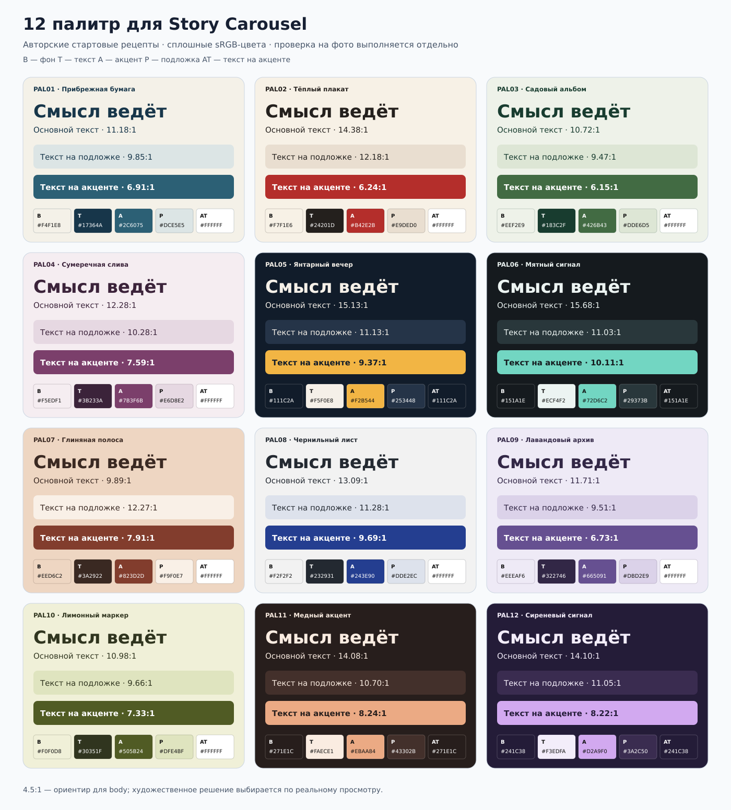

# Палитры от материала: стартовые пары и кириллические направления

**Версия:** 0.1 · **Проверка:** 6 ноября 2026 · **Статус:** авторские рецепты для сравнения, не обязательные пресеты. Наборы составлены для этого проекта; чужие каталоги палитр не копировались. Названия и сюжетные ассоциации — наши творческие подсказки, не универсальная психология цвета.

[Основное исследование](../../reports/story-carousel-research-2026-11-06.md) · [Композиции и ревью](composition-and-review.md) · [SVG-сводка](palette-catalog.svg).



SVG-сводка отрендерена и просмотрена. В ней используется служебная гарнитура для сравнения цветов; это не specimen перечисленных ниже шрифтов.

## 1. Роли и способ применения

**Приоритет — палитра конкретной истории.** Модель начинает с цветов/света реальных фотографий, темы, авторской интонации и бренда; распределяет роли, проверяет соседство, считает предложенные пары стандартным инструментом. Таблица ниже — 12 примеров и отправных точек, не каталог «на все случаи» и не обязательный шаг выбора пресета. Извлечённый доминирующий цвет фотографии тоже не обязан становиться фоном: выбор остаётся композиционным.

- **B / bg:** основной фон. **T / text:** основной текст. **A / accent:** цветовой акцент, плашка или выделенная надпись. **P / panel:** спокойная подложка. **AT / on-accent:** текст на акцентной плашке.
- Каждый рецепт содержит 4–5 уникальных цветов: AT иногда совпадает с B. Роли важнее буквального повторения HEX во всей истории; модель может адаптировать набор и заново оценить соседство.
- Сначала примеряем 2–3 подходящих набора на **реальном crop фотографии, заголовке и соседних карточках**, затем выбираем. Полоски цветов не доказывают качество готовой композиции.
- Для основного текста используем **4.5:1 как reference**; это не автоматический запрет художественного заголовка или выбора владельца. Выразительный display и generated lettering смотрим в фактическом телефонном размере; большой кегль исходника сам по себе не доказывает читаемость. [W3C: Contrast Minimum](https://www.w3.org/WAI/WCAG22/Understanding/contrast-minimum.html).
- Ни этот каталог, ни один contrast ratio не являются сертификацией социальной картинки по WCAG. Читаемость, шрифтовая форма, текстура и смысл остаются предметом просмотра.

## 2. Двенадцать конкретных палитр

| ID / название | B · фон | T · текст | A · акцент | P · подложка | AT · на акценте | Где пробовать |
|---|---|---|---|---|---|---|
| PAL01 · Прибрежная бумага | `#F4F1E8` | `#17364A` | `#2C6075` | `#DCE5E5` | `#FFFFFF` | Город, вода, документальный фотоочерк |
| PAL02 · Тёплый плакат | `#F7F1E6` | `#24201D` | `#B42E2B` | `#E9DED0` | `#FFFFFF` | Сильная фраза, предмет, исторический акцент |
| PAL03 · Садовый альбом | `#EEF2E9` | `#183C2F` | `#426B43` | `#DDE6D5` | `#FFFFFF` | Место, природа, спокойное объяснение |
| PAL04 · Сумеречная слива | `#F5EDF1` | `#3B233A` | `#7B3F6B` | `#E6D8E2` | `#FFFFFF` | Культура, голос автора, цитата |
| PAL05 · Янтарный вечер | `#111C2A` | `#F5F0E8` | `#F2B544` | `#253448` | `#111C2A` | Ночной сюжет, metric hero, крупная форма |
| PAL06 · Мятный сигнал | `#151A1E` | `#ECF4F2` | `#72D6C2` | `#29373B` | `#151A1E` | Современное объяснение, схема, контрастный объект |
| PAL07 · Глиняная полоса | `#EED6C2` | `#3A2922` | `#823D2D` | `#F9F0E7` | `#FFFFFF` | Архитектурная фактура, материальный объект |
| PAL08 · Чернильный лист | `#F2F2F2` | `#232931` | `#243E90` | `#DDE2EC` | `#FFFFFF` | Досье, сравнение, работа с документом |
| PAL09 · Лавандовый архив | `#EEEAF6` | `#322746` | `#665091` | `#DBD2E9` | `#FFFFFF` | Редакционная история, мягкая типографическая пауза |
| PAL10 · Лимонный маркер | `#F0F0D8` | `#30351F` | `#505B24` | `#DFE4BF` | `#FFFFFF` | Маршрут, заметка, выделение ключевого тезиса |
| PAL11 · Медный акцент | `#271E1C` | `#FAECE1` | `#EBAA84` | `#43302B` | `#271E1C` | Предмет, тёплый свет, выразительная цифра |
| PAL12 · Сиреневый сигнал | `#241C38` | `#F3EDFA` | `#D2A9F0` | `#3A2C50` | `#241C38` | Плакатный текст, контраст крупностей, коллаж |

## 3. Рассчитанный контраст

Числа — отношения **X:1**, рассчитанные для непрозрачных плоских sRGB-цветов. T/B = основной текст на фоне; T/P = основной текст на подложке; A/B и A/P = акцент как текст; AT/A = текст на акцентной плашке. Контраст симметричен, но роли в композиции — разные.

| ID | T/B | T/P | A/B | A/P | AT/A |
|---|---:|---:|---:|---:|---:|
| PAL01 | 11.18 | 9.85 | 6.12 | 5.39 | 6.91 |
| PAL02 | 14.38 | 12.18 | 5.55 | 4.70 | 6.24 |
| PAL03 | 10.72 | 9.47 | 5.42 | 4.79 | 6.15 |
| PAL04 | 12.28 | 10.28 | 6.61 | 5.53 | 7.59 |
| PAL05 | 15.13 | 11.13 | 9.37 | 6.89 | 9.37 |
| PAL06 | 15.68 | 11.03 | 10.11 | 7.11 | 10.11 |
| PAL07 | 9.89 | 12.27 | 5.66 | 7.02 | 7.91 |
| PAL08 | 13.09 | 11.28 | 8.66 | 7.46 | 9.69 |
| PAL09 | 11.71 | 9.51 | 5.68 | 4.62 | 6.73 |
| PAL10 | 10.98 | 9.66 | 6.34 | 5.58 | 7.33 |
| PAL11 | 14.08 | 10.70 | 8.24 | 6.26 | 8.24 |
| PAL12 | 14.10 | 11.05 | 8.22 | 6.45 | 8.22 |

Все пары T/B и T/P здесь выше 9.47:1; минимальный результат среди всех пяти сочетаний — 4.6158:1 (PAL09, A/P). Таблица округлена до двух знаков только для чтения; сравнение с ориентиром выполнено до округления. **Другие перестановки цветов не проверены этой таблицей:** например, T на A может быть непригоден, поэтому для плашки задан отдельный AT.

### Как воспроизведён расчёт

По [определениям W3C: относительная яркость и contrast ratio](https://www.w3.org/TR/WCAG22/#dfn-relative-luminance): каждый канал sRGB нормализуется в 0–1 и линеаризуется; затем считается яркость и отношение светлого/тёмного. Расчёт выполнен для всех 60 сочетаний.

```js
const linear = c => c <= 0.04045 ? c / 12.92 : ((c + 0.055) / 1.055) ** 2.4;
const luminance = hex => {
  const [r, g, b] = hex.slice(1).match(/../g).map(v => linear(parseInt(v, 16) / 255));
  return 0.2126 * r + 0.7152 * g + 0.0722 * b;
};
const contrast = (a, b) => {
  const x = luminance(a), y = luminance(b);
  return (Math.max(x, y) + 0.05) / (Math.min(x, y) + 0.05);
};
```

### Фото, прозрачность и generated lettering

Табличные ratios перестают описывать результат, если подложка полупрозрачная, фон фотографический, в буквах есть текстура или на слой наложен эффект. Оцениваем **финальный композит на фактическом crop**, включая самые трудные участки непосредственно под буквами; средний цвет всей фотографии не подходит. Если нужна правка, модель может переместить надпись, изменить локальную подложку/градиент, масштаб или рисунок букв. Каждый способ сравнивается по реальному результату; тень не считается универсальным исправлением.

Цвет не должен быть единственным способом отличить важные категории: помогать могут подпись, форма или расположение. Проверка цветовых отношений и светлотной структуры дополняет просмотр; она не заменяет художественный выбор. [W3C: Use of Color](https://www.w3.org/TR/WCAG22/#use-of-color).

## 4. Шесть направлений кириллической типографики

В каждой истории нужен хотя бы один сильный типографический момент; возможна целая карточка без медиа. Семь проверенных baseline-семейств сохранены: **Oswald, Golos Text, Inter, Source Serif 4, Manrope, Lora, Literata**. Новые кандидаты расширяют характер, не заменяют базу.

| Направление | Стартовые кандидаты и роли | Когда пробовать | Что смотреть |
|---|---|---|---|
| D01 · Condensed / узкий плакат | **Oswald** для display + **Golos Text** для пояснения | Короткая сильная фраза, вертикальный ритм, плотный акцент | Просветы букв после уменьшения, длину русского слова и ритм строк; не сжимать обычную гарнитуру по горизонтали ради имитации condensed |
| D02 · Neutral / ясный гротеск | **Inter**, **Golos Text** или **Manrope**; выбрать роли, а не смешивать все автоматически | Информация, подписи, спокойная основа рядом с выразительным объектом | Воспринимаемую высоту и массу, различие ролей, реальные цифры/знаки; «нейтральный» не означает отсутствие сильного масштаба |
| D03 · Serif / редакционный | **Source Serif 4**, **Lora** или **Literata** + Inter/Golos Text для поддержки | История места, цитата, вдумчивая типографическая пауза | Тонкие детали, интервалы, курсив только из реального ресурса; у variable-версий фиксировать использованные оси |
| D04 · Wide / широкий монументальный | **Unbounded** + Golos Text/Inter | Короткое имя, число или фраза как большая форма | Длинные слова и переносы, объём занимаемой площади; не жертвовать пояснением ради ширины display |
| D05 · Script / авторская рукописность | **Caveat** либо **Marck Script** + Golos Text/Manrope | Небольшая цитата, личная реплика, подпись как часть композиции | Кириллическую узнаваемость, соединения и строковый ритм на 360/320 px; это стилизация, не доказательство настоящего автографа |
| D06 · Generated lettering | Dot создаёт выразительную надпись: узкую, широкую, фактурную, рукотворную или пространственную; typeset/hybrid остаются доступными | Обложка, поворот, typography-only или metric hero; направление задаёт модель по смыслу | Точный canonical text, OCR + визуальное прочтение финального монтажа, кромки, маски и миниатюру. Метрики шрифта не доказывают качество сгенерированных букв |

Палитра не закрепляется навсегда за направлением. Например, D01 можно сравнить на PAL02 и PAL05, D03 — на PAL01/PAL04/PAL07, D04 — на PAL08/PAL12; это гипотезы для скетча, не предписания. Рукописный или сгенерированный текст не обязан выглядеть как готовая гарнитура. Для каждого выбранного компонента сохраняются точная строка и происхождение результата.

## 5. Первичные источники шрифтов и границы проверки

У всех десяти перечисленных семейств официальный Google Fonts metadata объявляет **cyrillic**; SIL OFL **1.1** подтверждена соответствующими OFL.txt. Семь baseline-семейств проверены в основном исследовании; три новые пары METADATA/OFL прочитаны непосредственно при подготовке этого каталога. Это проверка официальной поставки, **не проверка cmap каждого бинарного файла или всех нужных глифов**. Перед использованием проверяется выбранный файл и реальный текст, включая Ё/Й/№/₽, даты и смешанную кириллицу/латиницу.

| Семейство | Подтверждённый контекст | Первичные файлы |
|---|---|---|
| Oswald | База; узкий display | [METADATA.pb](https://github.com/google/fonts/blob/main/ofl/oswald/METADATA.pb) · [OFL.txt](https://github.com/google/fonts/blob/main/ofl/oswald/OFL.txt) |
| Golos Text | База; спокойный основной текст | [METADATA.pb](https://github.com/google/fonts/blob/main/ofl/golostext/METADATA.pb) · [OFL.txt](https://github.com/google/fonts/blob/main/ofl/golostext/OFL.txt) |
| Inter | База; нейтральная иерархия | [METADATA.pb](https://github.com/google/fonts/blob/main/ofl/inter/METADATA.pb) · [OFL.txt](https://github.com/google/fonts/blob/main/ofl/inter/OFL.txt) |
| Source Serif 4 | База; редакционная антиква | [METADATA.pb](https://github.com/google/fonts/blob/main/ofl/sourceserif4/METADATA.pb) · [OFL.txt](https://github.com/google/fonts/blob/main/ofl/sourceserif4/OFL.txt) |
| Manrope | База; геометрический гротеск | [METADATA.pb](https://github.com/google/fonts/blob/main/ofl/manrope/METADATA.pb) · [OFL.txt](https://github.com/google/fonts/blob/main/ofl/manrope/OFL.txt) |
| Lora | База; антиква для акцента/цитаты | [METADATA.pb](https://github.com/google/fonts/blob/main/ofl/lora/METADATA.pb) · [OFL.txt](https://github.com/google/fonts/blob/main/ofl/lora/OFL.txt) |
| Literata | База; редакционное чтение | [METADATA.pb](https://github.com/google/fonts/blob/main/ofl/literata/METADATA.pb) · [OFL.txt](https://github.com/google/fonts/blob/main/ofl/literata/OFL.txt) |
| Unbounded | Новая проверка; normal, wght 200–900; cyrillic + cyrillic-ext | [METADATA.pb](https://github.com/google/fonts/blob/main/ofl/unbounded/METADATA.pb) · [OFL.txt](https://github.com/google/fonts/blob/main/ofl/unbounded/OFL.txt) |
| Caveat | Новая проверка; normal, wght 400–700; cyrillic + cyrillic-ext | [METADATA.pb](https://github.com/google/fonts/blob/main/ofl/caveat/METADATA.pb) · [OFL.txt](https://github.com/google/fonts/blob/main/ofl/caveat/OFL.txt) |
| Marck Script | Новая проверка; normal 400; cyrillic; cyrillic-ext не объявлен | [METADATA.pb](https://github.com/google/fonts/blob/main/ofl/marckscript/METADATA.pb) · [OFL.txt](https://github.com/google/fonts/blob/main/ofl/marckscript/OFL.txt) |

Для Marck Script в OFL указан Reserved Font Name «Marck Script»; в metadata не объявлена расширенная кириллица. Это не означает отсутствие конкретного знака: ответ даёт проверка файла/строки. Unbounded и Caveat поставляются как variable normal; Marck Script — normal 400. Не приписываем им дополнительные начертания или синтетический курсив как отдельную проверенную поставку.

Новые metadata указывают реальные upstream-источники: [Unbounded](https://github.com/googlefonts/unbounded/tree/f3ec43228a864a72487e41552e2140efab9884ea), [Caveat](https://github.com/googlefonts/caveat/tree/59745e818ef7973e11e70cb1358d0e902b56c5fc), [Marck Script](https://github.com/googlefonts/marckscript/tree/f4e66d73d1cc7190be547d491b99a0979c60fb10). На сервере сохраняются фактически использованные bytes, версия и лицензия; каталог не подменяет font pack.

## 6. Как выбирать в процессе

Модель предлагает несколько реальных фрагментов с разными палитрой/типографическим характером, смотрит каждый в контексте фотографии и соседних карточек, затем объясняет, что стало выразительнее и какой компромисс появился. Числа контраста помогают диагностике. Они не назначают победителя и не превращаются в автоматический эстетический запрет.

