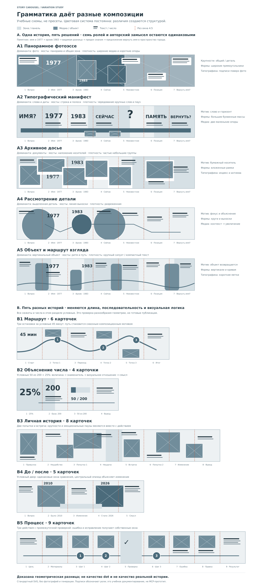

# Проверка вариативности композиционной грамматики

6 ноября 2026. Учебное документирование после [уточнения Opus на 9fdddf7](https://github.com/onedayonemasterpiece/vibepublish/blob/9fdddf7620e41e36132cb112630f0d85be44e3ef/docs/reports/story-carousel-critique-2026-11-06.md).

**Доказана геометрическая разница, не качество dot и не качество реальной истории.** Это десять авторских схем без фотографий, генерации и вызова MCP. Они иллюстрируют применение грамматики; это не набор пресетов, обязательных шаблонов или исчерпывающих стилей.

## 1. Одна история, пять композиций

Во всех A1–A5 одинаковые семь ролей и фактическое ядро текущего исследования: вопрос о памятнике; имя «Памятный знак советско-польской дружбы», проспект Калинина, 1977 год, Е.А. Попов; архив с атрибуцией 1983; видимая разница на предоставленных фотографиях; неизвестная причина изменений; авторская позиция о памяти дружбы; предложение вернуть имя в пространство города. Дата не изображается метрикой успеха. Архив в схемах — placeholder, его права не предполагаются разрешёнными. [Смысловое ядро и исторические опоры](../../reports/story-carousel-research-2026-11-06.md).

Последовательность одинакова: **вопрос → имя/1977 → архив/1983 → нынешний вид → предел знания → позиция → вернуть имя?** Поэтому различие геометрии не получено подменой фактов. Полные тексты и реальные фото не набирались пять раз: подписи окон обозначают содержательные роли, а блоки — их предполагаемое размещение.

| ID | Доминанта | Мосты / мотив | Плотность и формы | Типографическое направление |
| --- | --- | --- | --- | --- |
| A1 | Широкие фотообласти | Панорама, продолжающаяся зона, смена крупности | Много медиа; несколько коротких пояснений; прямоугольники | Подписи поверх фото, дата как локальная опора |
| A2 | Слова, вопрос и даты | Общая полоса, буквенные массы | Крупные слова чередуются с пустотой; фото малы | Выразительный гротеск и число-дата |
| A3 | Документы и небольшие фото | Перекрывающиеся носители, архивная фактура | Частые группы, вложения, рамки | Антиква для дат, компактные подписи |
| A4 | Деталь и её местоположение | Линии выносок, фокус/увеличение | Разреженная композиция; круги и тонкие связи | Короткие локальные метки |
| A5 | Высокий объект, повтор формы | Путь взгляда и возвращение вертикального мотива | Чередование силуэта и пояснения; вертикали и кривая | Небольшие сильные смысловые опоры |

У каждого варианта различаются минимум три содержательные оси: доминанты, мосты, плотность/распределение масс, геометрия форм, сквозной мотив и роль типографики. Цветовая система сохранена общей, поэтому визуальная разница не объясняется сменой палитры.

## 2. Пять разных историй

Все сюжеты и числа B1–B5 условные. Они демонстрируют разные задачи; это не утверждения о реальных объектах или событиях.

| ID / сюжет | N | Последовательность | Отличительные оси |
| --- | --- | --- | --- |
| B1. Маршрут | 6 | Старт → точка 1 → переход → точка 2 → точка 3 → итог | Путь и остановки, чередование картинок/переходов, три узла. 45 минут — условная длительность |
| B2. Объяснение числа | 4 | 25% → база 200 → 50 из 200 → вывод | Число-доминанта, знаменатель, доля 1/4 на общей шкале; без фотографий |
| B3. Личная история | 8 | Привычка → неудобство → попытка 1 → неудача → встреча → попытка 2 → изменение → вывод | Неравномерные фотоокна, пауза после неудачи, изменение масштаба по роли эпизода |
| B4. До/после | 5 | Вопрос → было/2010 → изменение → стало/2026 → смысл | Два равных окна, центральное объяснение, общая подложка. Даты условные |
| B5. Процесс | 9 | Цель → материалы → шаг 1 → шаг 2 → проверка → шаг 3 → ошибка → правка → результат | Ось трёх действий, отдельная проверка, пара ошибка/правка, финальный результат |

Число карточек следует смысловым эпизодам. Разные N показаны при одном размере окна, а не горизонтальным растяжением той же полосы. Это иллюстрация принципа: dot создаёт структуру под рассказ, а не выбирает один из десяти рисунков.

## 3. Что эта проверка устанавливает

Наблюдаемо различаются размеры и положения доминант, виды переходов, число/форма медиа, объём пустоты, роль букв и чисел. Сохраняются постоянная легенда, формат окна 4:5 и единая цветовая система. Блоки специально простые: зритель сравнивает структуру до фактуры и фото.

Не проверены качество генерации dot, понимание полного текста читателем, реальная эстетика, техническая передача компонентов через MCP и отображение на площадках. Сам по себе рисунок геометрии не доказывает результативность будущего процесса. После безгенерационного прототипа кодового агента dot строит собственные скетчи по краткому естественному поручению, смотрит их и объясняет различия.

## 4. Артефакт и просмотр

SVG: 1560 × 3460 px. Каждое окно: 150 × 187,5 px, 4:5. A1–A5: по 7 окон; B1–B5: 6, 4, 8, 5 и 9. Отрендерено Inkscape и просмотрено как фактический PNG; этап генерации изображений не выполнялся. Учебные подписи и фигуры не заменяют корректуру будущей готовой карусели.
