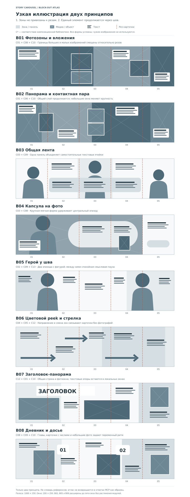

# Визуальный язык Story Carousel: приёмы и практические заготовки

**Status: Draft / Not confirmed by user.** 6 ноября 2026. Это дополнение к [C01–C16 и банку вопросов](composition-and-review.md), а не новый обязательный классификатор. E01–E23 — наблюдения из [Slack-реестра](source-register.md); P01–P40 ниже — перекрёстные ссылки на [критику Opus](../../reports/story-carousel-critique-2026-11-06.md).

Сначала выбрать приём по роли истории и материалам, затем посмотреть его на реальном холсте. Библиотека предлагает варианты и несколько вопросов. Наличие записи не означает доказанной эффективности, прав на чужой шаблон или обязательного применения.

## 1. Что было недоработано

Прежние T/C уже покрывали панораму, объект-мост, общую панель, диагональ, коллаж, метрики и типографическую карточку. Не хватало ремесленной конкретики: зон вне сетки, форм масок, вложенных фото, героя, повторов текста, навигации и брендового слоя. Главное дополнение — конкретный визуальный словарь и наши схемы, а не увеличение обязательного чеклиста.

| Семейство | Варианты исполнения | Опоры |
| --- | --- | --- |
| Пространственные зоны | Фотозоны и цветовые поля вне сетки, общая панорама, peek следующего поля | E01, E04, E05, E10, E19 |
| Большая панель | Капсула, закруглённая лента, асимметричная округлая форма, полоса поверх фото | E02/E20, E19, E23 |
| Фотоокна и вложения | Наложение, стопка из 2–3, контактная группа, рамка, скотч | E01–E07, E17, E18, E21 |
| Фигура и действие | Body/face split, сквозная роль/герой, жест/движение через границу | E03, E11–E16, E22 |
| Маска как язык | Круг, овал, арка, мягкий контур, рваная кромка | E02/E20, E18, E19, E21 |
| Тональный мотив | ЧБ/селективный цвет, ограниченная палитра, фактура, спокойная подложка | E11, E13–E15, E19, E21, E23 |
| Типографический образ | Слово через шов, большой фоновый текст, повтор-стопка, эхо, вертикальная строка | E02/E20, E17–E19, E23 |
| Типографический акцент | Узкий/широкий headline, одно выделенное слово, скрипт, страйпы, маркер, зачёркивание | E02, E09–E18, E21, E23 |
| Навигация и бренд | Линия/точки, стрелка, peek, номер, шапка/подвал, автор/бренд | E09–E16, E22, E23 |
| Рисованный слой | Петля, пунктир, лучики, речевой пузырь, чат-пилюля | E13–E16, E21 |
| Объект-метафора и носитель | Ракета, лампа, мегафон, камера; экран/табличка/витрина | E02, E19, E22, E23 |
| Число и время | Метрика-стикер, контурная цифра, призрачный номер, глава-дата | E19, E21, E22 |
| Финальное действие | Вопрос, сохранение/пересылка, авторская подпись, комментарий по смыслу | E12–E15, E19, E21, E23 |

### 1.1. Грамматика и оси вариативности

[Дополнение Opus на 9fdddf7](https://github.com/onedayonemasterpiece/vibepublish/commit/9fdddf7620e41e36132cb112630f0d85be44e3ef) переносит акцент с каталога раскладок на самостоятельное построение. Под «грамматикой» понимаем профессиональный язык для модели: элементы, отношения, варианты их применения. Это не обязательный JSON/DSL и не ограничение свободы стандартного редактора.

**Элементы:** фоновые поля и зоны; фото и произвольные маски; вырезанные объекты; текстовые блоки/полосы/слова/числа; линии и другие мосты; фоновой мотив; бренд и навигация. **Отношения:** доминанта и поддержка; близость и принадлежность; перекрытие и глубина; продолжение и пауза; повтор с изменением; локальное чтение и смысл целого. Модель назначает их по истории, затем смотрит фактическую картинку.

| Ось изменения | Что можно менять независимо |
| --- | --- |
| Доминанты по эпизодам | Фото, слово, число, фигура, карта, цитата, сознательная пауза |
| Мосты | Зона, фото, объект, панель, линия, надпись, движение; типы не обязаны механически чередоваться |
| Ритм | Общий/деталь, плотность, длительность визуальной паузы, место кульминации |
| Формы и материал | Прямоугольник, капсула, арка, органика, рваный носитель, плоский слой |
| Сквозной мотив | Герой, контур, фоновое слово, нить, фактура, повтор цвета или отсутствие отдельного мотива |
| Повествование | Число окон 4–9, роли и порядок раскрытия при сохранении фактов/авторского intent |
| Медиа и текст | Исходная фотография, честный коллаж, ЧБ/цвет, контраст крупностей, узкий/широкий/редакционный/рукописный характер |
| Палитра | Цвета и роли из материала, темы и бренда; рассчитанный контраст на реальном композите |

Варианты различаются по нескольким содержательным осям, а не только оттенком. «Две оси» — полезный вопрос к сравнению; требование трёх осей в [учебном разборе 5+5](variation-study.md) — способ показать разнообразие, не автоматическая приёмка каждой истории. Схемы B* ниже иллюстрируют отношения, а не предлагают выбирать template_id.

## 2. Что действительно видно в E01–E23

Проверены все 23 локальных файла. Название в таблице ведёт к реестру со Slack file ID; исходные чужие изображения в Git не копируются. Внешнее оформление презентации шаблона отделено от содержимого карусели.

| ID / файл | Наблюдаемые приёмы | Что уточнить относительно Opus |
| --- | --- | --- |
| [E01](source-register.md#2-реестр-референсов) | Пять окон, фото разных масштабов, наложения через рез, нижняя схема прямоугольников | Серые блоки обозначают также фото, а не только тональные фоны. Связность создают оба слоя |
| [E02](source-register.md#2-реестр-референсов) | Круги, овалы, асимметричная округлая маска, длинная капсула, повтор слова, вертикальный текст, плашки, ноутбук | Точная сетка резов в большинстве полос не проведена; не все предполагаемые текстовые пересечения можно локализовать с уверенностью |
| [E03](source-register.md#2-реестр-референсов) | Красная основа, разные фотоокна, большой cutout на резе, скрипт, перекрытие | Редакционно выразительная и цветная композиция: её не следует сводить к ЧБ + один акцент |
| [E04](source-register.md#2-реестр-референсов) | Четыре окна, большие фотообласти вне сетки, вставка на первом резе, две вертикально сложенные вставки | Нижние серые области — раскладка медиа. Повтор Slide 3 относится к подписи превью |
| [E05](source-register.md#2-реестр-референсов) | Десять схем: зоны, разномасштабные прямоугольники, стопки/контактные группы, рамки, паузы | Десять миниатюр читаются как силуэты. Точные координаты и функции каждого серого тона из этого растра не восстанавливаются |
| [E06](source-register.md#2-реестр-референсов) | Белые полосы, большие и малые свадебные фото, контактные группы, цветные и ЧБ кадры | Тёмная фактура заметна главным образом ВНЕ карусельных полос; это не доказательство общей тёмной фактуры каждой карусели |
| [E07](source-register.md#2-реестр-референсов) | Полароидные носители, скотч, несколько рамок пересекают рез, крупная панорама, светлая бумага | Индикатор и надпись под полосой — оформление демонстрации; их нельзя автоматически считать содержимым карточек |
| [E08](source-register.md#2-реестр-референсов) | То же изображение, что E07 | Не отдельная дизайнерская система |
| [E09](source-register.md#2-реестр-референсов) | Верхняя серия: чёрно-белые текстовые карточки, линия с точками, профиль/подвал; нижняя: несколько ярких цветов, стрелки, окна | Точки стоят примерно в одном локальном месте. Это не показанная анимация прогресса и не измерение «сколько осталось» |
| [E10](source-register.md#2-реестр-референсов) | Большие стрелки через стыки, правые полосы следующего фона, цветовой разворот, текстовые страйпы, номера, рамка | Хорошее явное основание для peek и системы навигации; заметен водяной знак стока |
| [E11](source-register.md#2-реестр-референсов) | Повтор героя в шляпе, оранжевый костюм, фиолетовый/светлый фон, face/body split, номера и стрелки | Более прямой источник для face split, чем E12 |
| [E12](source-register.md#2-реестр-референсов) | Сквозной бегущий герой, действие/финишная лента через границы, светлая складчатая поверхность, узкий заголовок | На 1|2 лицо первого героя остаётся в первой карточке: разделяются фигура/руки. Фото сохраняют цвет. Финальный портрет не круглый |
| [E13](source-register.md#2-реестр-референсов) | Лицо действительно разделено по 1|2; повтор портретного героя; ЧБ с акцентом; пунктир и дудлы | Именно этот файл — сильный пример face split, недооценённый в перечислении P07 |
| [E14](source-register.md#2-реестр-референсов) | Comic-пузыри, выборочный цвет, дудлы, общий крупный портрет на 5|6, финальный автор | На 3|4 продолжается фигура, не речевой пузырь. На 5|6 два пузыря по сторонам общего лица; не один пузырь через шов |
| [E15](source-register.md#2-реестр-референсов) | Разделённые портреты, тёмная фактура, фуксия, петли/стрелки, нумерация, автор в круге | Face split подтверждён; формулировку «везде точно пополам» не использовать без измерения |
| [E16](source-register.md#2-реестр-референсов) | Цветные бойцы/действие через рез, петли-стрелки, последовательный визуальный конфликт, узкая типографика | Не ЧБ-фото и не один постоянный герой. «Which is best for you?» — ранняя карточка, не финальный CTA. Финального портрета автора нет |
| [E17](source-register.md#2-реестр-референсов) | Заголовки и строки проходят через резы; крупные слова, скрипт, фото в рамках, бумажные зоны | Текстовый split реально есть; не следует утверждать, что все резы проходят только по пробелам/слогам |
| [E18](source-register.md#2-реестр-референсов) | Рваная бумага, многослойное фото, антиква, вертикальные подписи, раскладка SIM-/PLI-/CI-/TY | SIMPLICITY — ступенчатая композиция около границы; она не задаёт универсальный безопасный алгоритм разреза. Вертикальная подпись может быть РЯДОМ со швом |
| [E19](source-register.md#2-реестр-референсов) | Золотая длинная панель, закруглённая большая форма, арки, призрачное слово/номер, повтор персонажа, мокапы | P05 лучше подтверждается фоновым словом/орнаментом, а не конкретной эмблемой. «S-кривая» — слишком узкое название семейства |
| [E20](source-register.md#2-реестр-референсов) | Повтор семейства E02 в другом обзорном листе | Не независимое подтверждение новой школы или эффективности |
| [E21](source-register.md#2-реестр-референсов) | Авторский дневник, метрики-стикеры, главы MON/WED/FRI, чат-пилюли, волнистые зоны, фотоносители, keyword CTA | Числа и заявления об успехе — содержание шаблона, не проверенные результаты. Один дневниковый ряд показан дважды |
| [E22](source-register.md#2-реестр-референсов) | Ракета-мост, лица/фигуры через границы, сердца, контурные большие номера, стрелка/индекс в шапке | Есть навигационная рамка, но видимый индекс/стрелка не доказывает снижение оттока |
| [E23](source-register.md#2-реестр-референсов) | Фото+cutout, лампа/мегафон/камера, фоновое слово, эхо-текст, страйпы, маркер/зачёркивание, иконки, диагональная лента, постоянная шапка | Большой телефон вверху частично относится к презентации шаблона ВОКРУГ полосы. Не переносить внешнее оформление автоматически в карточки |

## 3. Связь с P01–P40 из критики

Это индекс обсуждения, без дублирования C-ID в будущем API. «Новое» означает нужное дополнение к справочнику, а не доказанный недостаток реализации: её ещё нет. Не каждый найденный приём требуется кейсу памятника.

| P-ID | Приём | Статус относительно baseline / опора |
| --- | --- | --- |
| P01 | Фоновые и фотозоны вне сетки | Недостаточно конкретно; E01/E04/E05, B01/B02 |
| P02 | Длинная органическая панель | C03 уже есть; формы расширены по E02/E19/E20, B03/B04 |
| P03 | Волна / рваный край | Вариант коллажа C08; E18/E21 |
| P04 | Диагональная лента | C04 есть; E23 |
| P05 | Тихий смысловой фоновой мотив | Новое явное требование владельца 19:50; эмблема не доказана самими E19/E23 |
| P06 | Общая фактура | T6 есть; E15. Тёмное окружение E06 не принимаем за фон полосы |
| P07 | Намеренный разрез лица/фигуры | Раньше излишне запрещён; E11/E13/E15/E22, B05 |
| P08 | Действие через шов | Объект-мост уже есть; E12/E16 |
| P09 | Сквозной герой | Новая конкретизация; E11/E12/E13/E19 |
| P10 | ЧБ + цветовой акцент | Арт-направление уже есть; E13/E14/E15, но не весь корпус E11–E16 |
| P11 | Стопка / контактная группа | C08/C10; E01/E04/E05/E06/E21, B01/B02/B08 |
| P12 | Сложная маска | Упомянута; добавлены формы E02/E19/E20, B04 |
| P13 | Полароид / скотч / фотоноситель | Альбомный стиль уже есть; E07/E08/E21 |
| P14 | Cutout-метафора / объёмный предмет | T2/C02; E22/E23. Не всякая вырезка обязана быть 3D |
| P15 | Экран / мокап | Новая прикладная роль; E02/E19. Внешний телефон E23 не переносим автоматически |
| P16 | Заголовок через шов | T10 был чрезмерно ограничен; E17/E18, B07 |
| P17 | Крупное фоновое слово | Новая типографическая операция; E19/E23 |
| P18 | Стопка повторов слова | Новая операция; E02/E20 |
| P19 | Вертикальная подпись | Новая операция; E02/E18; не обязательно на самой линии реза |
| P20 | Акцентное слово / строковая полоса | Упомянуто; E10/E12/E23; ниже практический alpha-рецепт |
| P21 | Призрачная / контурная цифра | C09 расширяется; E19/E22 |
| P22 | Рукописный контраст с набором | Режим hybrid уже есть; E03/E17/E18/E21 |
| P23 | Маркер / зачёркивание | Новая операция; E23 |
| P24 | Эхо-текст / повторный контур | Новая операция; E23 |
| P25 | Peek следующего эпизода | Owner principle; конкретизация E10, B06 |
| P26 | Линия / дудл-стрелка через шов | T4/C05 есть; E10/E13/E15/E16 |
| P27 | Прогресс | Кандидат навигации; E09 показывает линию/точки, не измеренную эффективность индикатора |
| P28 | Подсказка свайпа | Практический вариант навигации; уместность зависит от фактического клиента |
| P29 | Брендовая рамка | Новая явная схема; E10/E11/E12/E22/E23. Владелец требовал бренд хотя бы один раз |
| P30 | Номер карточки | Навигационный слой; E10–E12/E15/E16/E22/E23 |
| P31 | Дудлы / лучи / пунктир | Конкретизация графического слоя; E13–E16 |
| P32 | Речевой пузырь | Цитата уже есть; E14. Пузыри не являются общим мостом 3|4 |
| P33 | Чат-пилюля / наклейка | Новое исполнение; E21 |
| P34 | Метрика-стикер | C09 уже есть; E21. Числа шаблона не становятся проверенными результатами |
| P35 | Глава-дата | C05/временной сюжет; E21, B08 |
| P36 | Чеклист | Полезный кандидат; маркированный список не автоматически рассказ |
| P37 | Вопрос / опрос | Вопрос как CTA уже есть; E16. Нативная публикация опроса с альбомом не подтверждена |
| P38 | Комментарий по кодовому слову | E21; применять только если это соответствует задаче и возможностям канала |
| P39 | Сохранить / переслать | E23; иконка не обещает нативную кнопку или отслеживаемое действие |
| P40 | Финальный автор / портрет | E14/E15; не обязательный финал каждой истории |

## 4. Восемь иллюстраций композиционных принципов

Все полосы в атласе: пять окон 4:5. Серые области обозначают места медиа, цветные — общие зоны/панели, тёмные короткие блоки — текст. Координаты доступны в самом SVG. Это **наши интерпретации принципов**, не точная трассировка десяти миниатюр E05 и не конечный набор макетов. Dot строит новую геометрию по истории; возможные решения этими восемью примерами не ограничены. Каждая схема просмотрена после растрового рендера.

| Схема | С чем сравнить / зачем | Какие C* и E* помогают |
| --- | --- | --- |
| B01. Фотозоны и вложения | Зоны не совпадают с нарезкой; разная крупность | C01/C08/C10; E01/E05 |
| B02. Панорама и контактная пара | Общее пространство + деталь без нового полного кадра | C01/C06/C10; E04/E06 |
| B03. Общая лента | Одна панель держит несколько локальных тезисов | C03/C09; E19 |
| B04. Капсула на фото | Крупная мягкая форма создаёт место тексту и проходит через швы | C03/C08; E02/E20 |
| B05. Герой у шва | Сравнить намеренный split с размещением героя внутри окна | C02/C09/C13; E11/E13/E15 |
| B06. Цветовой peek и стрелка | Связность без фотографий, объявление следующей главы | C04/C05/C12; E10 |
| B07. Заголовок-панорама | Большая надпись как главный образ; проверка чтения окна/пары | C08/C12; E17/E18 |
| B08. Дневник / досье | Фотоносители, даты, стикеры и смена плотности | C05/C08/C09; E21 |

Для семи карточек сохраняем масштабы модулей, добавляем смысловой эпизод на два окна и переносим финальные объекты на +2W. Не растягиваем людей и буквы в 7/5 раза. Если дополнительного смысла нет, решаем это редактурой. Изготовление схем стандартным SVG не вводит новый scene compiler в продукт.

## 5. Правила применения шва

**Лицо и фигура.** Намеренный разрез допустим. Смотреть отдельное окно, пару, промежуточное окно и профиль площадки. Для портретной идентификации и документальной детали важно, что остаётся узнаваемым и что подтверждает изображение. Не вводить общий запрет по слову Telegram/VK.

**Текст.** Допустимы локальная фраза, заголовок через окна и буквенный слой как образ. Выбирать по обещанному способу чтения. Перенос по пробелу часто помогает, но не является универсальным запретом резать букву. Локальная опора должна позволять понять предмет; весь рассказ на каждой карточке не повторяется. Подпись поста дополняет доступность, но не исправляет плохую компоновку самой карточки.

**Фон.** Различать единый цвет, структурную зону, панораму и фактуру. Продолжающаяся зона может быть главным мостом. Не добавлять стрелку только ради формального наличия мостов. Положение границы по отношению к резу проверяется глазами; 60 px и 0,3W не доказанные нормы.

**Финал.** Повтор мотива может закрывать историю. Случайный peek/стрелка не должен обещать несуществующую карточку. Бренд хотя бы один раз; постоянная рамка опциональна и может исчезнуть на крупном фото, если авторство истории остаётся понятным.

## 6. Три недостающих производственных рецепта

### Generated lettering → прозрачные страйпы

1. Сохранить точную строку, роль, будущий размер и фон размещения. Генерировать художественную надпись с нужным рисунком и материалом.
2. Посмотреть реальный файл и исправить буквы. Выделить всю надпись или bbox каждой строки; bbox не должен обрезать выносные элементы и тени.
3. Получить прозрачный слой разрешённым инструментом; не считать белый фон альфой. Если подготовка/правка делается генератором, проверить результат повторно. После подготовки файл остаётся редактируемым компонентом, а строка — текстовым источником.
4. Передать исходные PNG/RGBA через проверенный original/file путь, не через нормализованную белую производную. Точный byte handoff ещё предстоит испытать.
5. Положить полосы в общий холст, проверить край на настоящем фоне, текст в масштабе телефона и переходы. При смене копирайта заменяется соответствующий компонент, не весь фон.

### Фон целиком либо сегментами по 2–3 карточки

Сначала выбрать роль и крупность текстуры. Общий фон легче держит единство, но большое растяжение может лишить деталь резкости. Сегменты сохраняют разрешение, зато требуют согласования света, перспективы и кромок. В задание dot входят bbox/размер, вид соседнего фрагмента, палитра и зоны будущего текста. Перекрытие или продолжение существующего края — возможный способ, один seed сам по себе не гарантирует совпадения. После монтажа сравниваются обе стороны стыка; при необходимости правится край, маска или конкретный сегмент. Реальный генеративный прогон отложен до E2E.

### Тихий смысловой мотив

Бренд, контекстный предмет, слово или исторический символ можно встроить в фон либо положить отдельным слоем. Отдельный слой проще двигать и менять, встроенный — проще объединить с фактурой; выбор зависит от реального результата. Начинаем с роли «вторичный», затем настраиваем видимость на фактическом фоне. Opacity, насыщенность и контраст — разные величины; «8%» не универсальная гарантия читаемости. Мотив не должен выдавать художественную реконструкцию за документальную деталь фотографии. После платформенного сжатия проверяется фактическая видимость.

## 7. Мотив, повествование и короткий просмотр

| История | Полезный сквозной мотив | Почему / оговорка |
| --- | --- | --- |
| Место и его деталь | Панорама, контур, фотоокна | Зритель ориентируется в одном пространстве |
| Было / стало | Повтор ракурса, рамка, дата | Сравнение должно быть честным по точке зрения и источникам |
| Человек в действии | Герой, жест, след движения | Не заставляет генерировать нового персонажа для каждого окна |
| Объяснение / аргумент | Общая панель, линия, типографический ритм | Связывает тезисы без случайного фото |
| Дневник / временная история | Главы-даты, носитель фото, повтор детали | Время различимо, но не имитирует доказанную причинность |
| Сильная авторская позиция | Повтор ключевого слова, цитата, возвращение фото | Эмоциональная выразительность сохраняет авторство мнения |

Для первого этапа полезны восемь приёмов, доступных без новой генерации: фотозоны, вложенные фото, общая панель, контролируемый split, линия/peek, крупная дата, авторская цитата и брендовый финал. Dot нужен, когда выбранный эффект требует **нового** художественного lettering/фона/объекта; сам тип приёма не делает генерацию обязательной.

Для скетча: Q01, Q03, Q14, Q29; для монтажа: Q12, Q23, Q30, Q31; для финала: Q08, Q13, Q33 и вопрос об изменённом участке. Это стартовая подборка из существующего банка, не новые 12 обязательных согласований. Вместе с референсом Vibe возвращает «что здесь переносим» (например, один общий радиус/масштаб), «что не переносим» (сюжет/плотность/чужое фото), нужную пару и одно наблюдаемое различие. Эффект на охват и «остановку пальца за секунду» этим просмотром не измеряется.

[Палитры и типографические направления](palette-catalog.md) · [Канонический MCP-процесс](../../features/story-carousel/README.md) · [Итог консультации](../../reports/story-carousel-reconciliation-2026-11-06.md).
