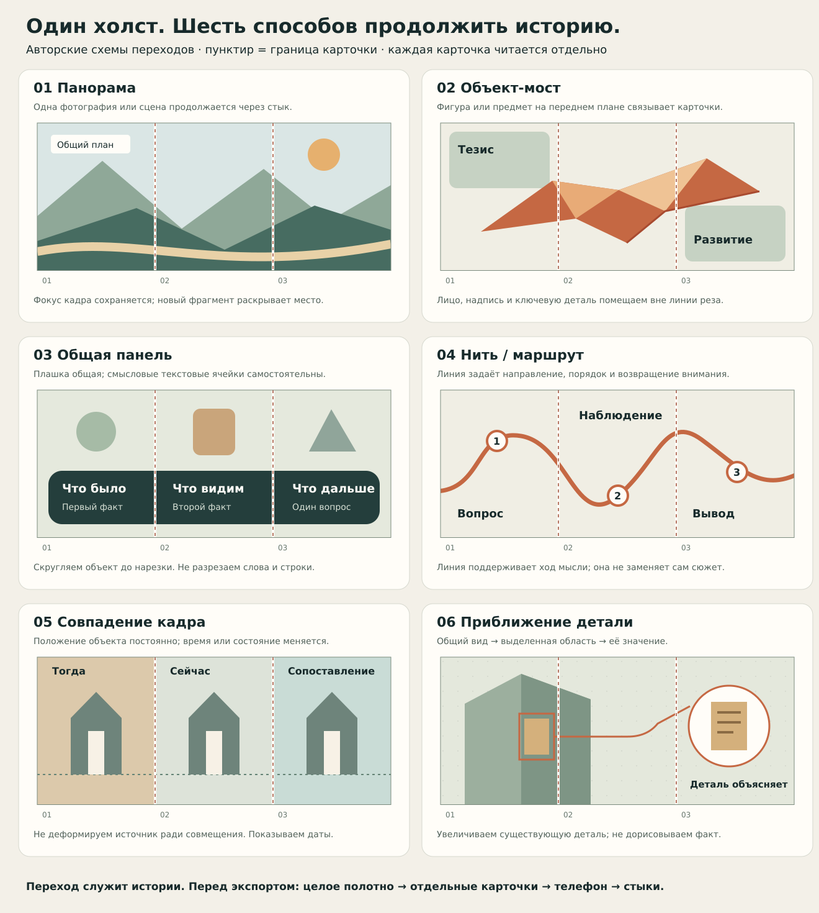

# Story Carousel: исследование, система приёмов и проект Vibe Publish MCP

**Дата:** 6 ноября 2026. **Статус:** Research / Draft; проект MCP — **Not confirmed by user**, реализация — **Not done**.

**Главный вывод:** историю следует создавать как единый редактируемый документ: смысл, доказательства, последовательность, медиа и общий холст. Карточки — точные окна этого холста. На каждом переходе есть визуальное продолжение, а у каждой карточки — законченный локальный смысл. Несколько вариантов должны отличаться режиссурой и композицией, сохраняя одни факты и материалы.

Это основной файл для обсуждения с владельцем и последующей консультации с Opus. Он объединяет исследование и решения; подробный будущий контракт находится в [Story Carousel / MCP design](../features/story-carousel/README.md). [Реестр источников и всех референсов](../reference/story-carousel/source-register.md) позволяет проверить наблюдения. [Авторский атлас переходов](../reference/story-carousel/transition-atlas.svg) иллюстрирует геометрию. [Композиционная библиотека и профессиональные вопросы](../reference/story-carousel/composition-and-review.md) дают рабочие рецепты и систему рекомендательного ревью.

В этой работе подготовлены исследование и проект, а не работающий генератор или утверждённый дизайн карусели. Консультация Opus ещё не проводилась: владелец передаст ему этот файл.

## 1. Что изучено и где границы доказательств

Прочитан весь доступный канал [#story-carousel](https://mira-projects.slack.com/archives/C0CFP01K292): все корневые сообщения, все пять тредов с ответами, корни классификации и нового E2E с dot. После первого среза канал перечитан; включены сообщения владельца до **19:41:20 по Калининграду**, в том числе последние уточнения о творческой полировке, ведущей роли модели, генерации через dot, сильной типографике и метриках. Тред [«Требования»](https://mira-projects.slack.com/archives/C0CFP01K292/p1793977084730169) использован только как источник; его сообщения не редактировались и ответы туда не добавлялись. Полнота и время среза зафиксированы в реестре.

Просмотрены **23 референса, 22 уникальных файла**: E07 и E08 побайтово одинаковы. Часть остальных файлов показывает повторяющиеся семейства шаблонов. Поэтому это не 22 независимые школы дизайна и не 22 подтверждённых успешных публикации.

Прочитан связанный тред о памятнике советско-польской дружбы, просмотрены все три исходные фотографии. Общий набросок 7 × 4:5 в PNG размером 21 MB не удалось получить: файловый инструмент ограничен 10 MB, браузерная ссылка открыла вход в Slack. **Нарезка и визуальная оценка именно этого большого полотна не выполнены.** План контрольного примера ниже основан на доступных фотографиях, тексте обсуждения и проверенных источниках, а не на предположении о дефектах недоступного изображения.

Внешнее исследование опирается на авторские методы, редакционные практики, официальные руководства и исследовательские работы. «Лучшие мировые подходы» здесь означает сильные, объяснимые и переносимые методы. Сравнительного эксперимента, доказывающего единственный лучший стиль или гарантированный прирост охвата, эти материалы не дают.

Различаем четыре уровня:

- **Наблюдение:** что действительно видно в файле или написано в проверенном источнике.
- **Авторская практика:** что рекомендует конкретный дизайнер или редакция.
- **Наша проектная рекомендация:** как применить это в Vibe Publish.
- **Гипотеза для проверки:** какой вариант сработает лучше на конкретном сюжете и аудитории.

## 2. Что уже есть в замысле владельца

Из обсуждения получаются следующие опоры: 4–9 карточек; единое полотно с итоговой нарезкой; основной эксперимент 4:5; объекты, фотографии и плашки переходят между карточками; изображения неполной высоты могут иметь скругления; возможны линия и таймлайн; отдельная генерация компонентов; готовые контрастные палитры; бренд «Полюбить Калининград» хотя бы один раз; сохранённая сущность истории; предварительный просмотр и выбор до публикации.

Поздние уточнения владельца включены в этот документ: генерация надписей для выразительного узкого/широкого рисунка; ситуативная плотность и возможность платных шрифтов; **скетч общего холста → палитра → типографика → генерация компонентов → монтаж**; поиск и кеширование SVG-иконок по смыслу и стилю с повторным использованием прежнего подхода events-bot. Дополнительно нужны библиотека композиций, правила сочетаемости и узкие профессиональные вопросы, заставляющие агента оценить конкретные стороны результата. Композиционные советы остаются рекомендательными и не запрещают владельцу принять осознанное художественное решение.

Владелец хочет давать исходный смысл естественно — текстом, ссылкой, фото или голосовым в Slack. Технические поля, последовательность действий и контроль качества должен организовать агент через MCP. Пользователь не обязан самостоятельно заполнять дизайнерский JSON.

**Последнее уточнение меняет архитектурный акцент:** основную творческую работу ведёт модель, пользуясь стандартными инструментами. MCP сохраняет состояние и поддерживает процесс; собственный детерминированный дизайнер, жёсткие эстетические фильтры и избыточные подтверждения не нужны. Сначала кодовый агент отрабатывает технологию без новой генерации; затем dot создаёт компоненты и проходит MCP в выделенном E2E-треде. В каждой истории должен быть сильный типографический момент, включая полностью текстовые карточки; при наличии проверенных метрик число может стать главным визуальным элементом.

### Что следует добавить к этой основе

| Область | Уже присутствует | Предлагаемое дополнение |
| --- | --- | --- |
| Смысл | Хук, тезисы, цитата, CTA | Один обещанный результат чтения; роль каждого кадра; завершение без искусственного тизера |
| Источники | Исходные медиа и поиск | Связь каждого фактического тезиса с источником; разделение факта, наблюдения, версии и позиции автора |
| Переходы | Общая картинка, объект, линия, плашка | Словарь переходов с функцией и условиями; защищённые области фото; явный план каждого стыка |
| Типографика | Узкие/широкие выразительные надписи, в том числе генеративные | Точная исходная строка; режим исполнения каждого блока; для набора — закреплённый шрифт, для генерации — корректура изображения |
| Иконки | Поиск темы и стиля, прямое применение или референс для генератора | Общая библиотека и кеш, источник/лицензия, проверка глазами, устойчивый серверный интерфейс |
| Варианты | Возможность выбирать лучшее | Сравнимые A/B/C с одним фактическим ядром и различиями минимум по двум содержательным осям |
| Правки | Возможность доработать | Стабильные ID объектов; изменение конкретной карточки/перехода без повторной генерации всего |
| Просмотр | Полотно в 50% с линиями реза | Дополнительно отдельная карточка на телефоне, последовательное листание и соседние пары |
| Композиция и ревью | Правила, сочетаемость, доминанты, сквозной смысл, целостность | Версионируемые композиционные рецепты; вопросы по этапу; наблюдение → локальная правка → осознанное решение, без автоматического эстетического запрета |
| Управление | Сохранённая история | Неизменяемые версии, происхождение ассетов, бюджет генерации, проверяемая сборка экспорта |

Это предложения к проекту. Они не переписывают Slack-тред требований и не означают принятия нового продуктового контракта владельцем.

## 3. Учебный маршрут и сильные внешние подходы

Ниже — практический маршрут, а не бесконечный каталог похожих роликов. Видеоуроки найдены по авторским страницам; их полный просмотр не заявляется. Технические шаги, на которые опирается проект, подтверждены доступными текстами и документацией.

| Источник | Зачем открыть | Что переносим; граница применимости |
| --- | --- | --- |
| [Canva Design School — How to create carousels worth swiping for](https://www.canva.com/design-school/resources/how-to-create-instagram-carousels-worth-swiping-for/) | Короткий вводный урок, заявленная длительность 6 минут | Структурирование, перестановка карточек, замена медиа, работа с шаблоном. Прочитана страница курса; это не спецификация сложного общего холста |
| [Chris Do — Seamless Instagram Carousel Posts](https://www.linkedin.com/posts/thechrisdo_seamless-instagram-carousel-posts-activity-7041437835979100160-Crsm) | Самое короткое объяснение пространственного принципа | Автор описывает широкую композицию и сдвиг X на ширину кадра в Keynote, ссылаясь на David Talas. Важен общий координатный принцип, а не выбор конкретного редактора |
| [François Fourmy — Seamless Instagram Carousel](https://www.francoisfourmy.com/product-page/seamless-instagram-carousel) и [его Photoshop tutorial](https://www.youtube.com/watch?v=Er7mMt-tAk4) | Посмотреть производство панорамы через guides и slices | Авторская страница подтверждает заранее настроенные направляющие и нарезку общей композиции. Коммерческие шаблоны не приобретались; обещания engagement не использованы как доказательства |
| [Adobe — Manage slices in Photoshop](https://helpx.adobe.com/photoshop/desktop/save-and-export/save-files/manage-slices-in-photoshop.html) | Проверить точную геометрию экспорта | Числовые X/Y/Width/Height и деление slices. Производственный вывод: кратный размер полотна, одинаковые окна, отсутствие остаточной полосы |
| [The Futur — How to Design Seamless Instagram Carousels in Illustrator](https://www.youtube.com/watch?v=QBE3WcIAmYM) | Дополнительный ручной просмотр работы в Illustrator | Релевантная авторская видео-ссылка найдена, но ролик не просмотрен. Не используем якобы извлечённые из него подробные инструкции |
| [The Pudding — Making Internet Things, Part 3: Storytelling](https://pudding.cool/process/how-to-make-dope-shit-part-3/) | Научиться выбирать вопрос и последовательность | Аудитория, главный вывод, контекст, разбиение аргумента; автор отдельно обсуждает короткие Instagram-карусели. Полезно до декоративного дизайна |
| [Google — Web Stories best practices](https://developers.google.com/search/docs/appearance/web-stories-creation-best-practices) | Сопоставить с близким последовательным форматом | Контекст, развитие и завершение, неперекрытый текст, осмысленная анимация. Числа и предпочтения Web Stories не становятся универсальными нормами для карусели |
| [Nieman Lab — интервью с Jake Grovum о карточках NYT](https://www.niemanlab.org/2021/07/the-new-york-times-is-using-instagram-slides-and-twitter-cards-to-make-stories-more-digestible/) | Увидеть редакционный подход к объяснению сложных тем | Карточки дают контекст, используют карты и данные, должны оставаться понятными после скриншота. Интервью 2021 года не является текущей спецификацией платформ |
| [Knight Lab — Introducing JuxtaposeJS](https://knightlab.northwestern.edu/2014/09/24/introducing-juxtaposejs-an-easy-way-to-compare-two-frames/index.html) | Изучить ясное сопоставление двух состояний | Выравнивание «тогда / сейчас», подписи, авторство фото. Для карусели переносим метод сравнения; сам интерактивный ползунок в изображения не превращается |
| [Segel & Heer — Narrative Visualization, 2010](https://idl.uw.edu/papers/narrative) | Разделить жанр рассказа и способ ведения читателя | Научная рамка жанров и баланса авторского маршрута с исследованием читателя. Основание для многомерной классификации, не рейтинг соцсетевых шаблонов |
| [Figma — Export formats and settings](https://help.figma.com/hc/en-us/articles/13402894554519-Export-formats-and-settings-for-static-designs) | Проверить выдачу макета | Разница редактируемого документа и растрового/векторного экспорта. Для мелкого текста проверяем качество фактического файла, а не только макета |
| [Conlen & Heer — Fidyll, 2022](https://arxiv.org/abs/2205.09858) | Обсудить архитектуру с Opus | Прецедент компиляции одной истории в разные форматы. Используем как архитектурную аналогию; это не готовый движок Vibe Publish |

**Рекомендуемая очередность:** Canva → Chris Do → Fourmy + Adobe → The Pudding → собственный storyboard → проверка экспорта. Для архитектурной консультации затем Segel/Heer и Fidyll.

В редакционных примерах важнее не воспроизвести внешнюю фактуру, а понять функцию: NYT добавляет необходимый контекст; The Pudding управляет последовательностью аргумента; Juxtapose делает изменение наблюдаемым. Для городского проекта это сильнее, чем копирование очередного набора «5 причин».

## 4. Классификация: три независимые оси

Не стоит складывать в один список «таймлайн», «бежевый», «Bebas» и «фото через стык»: это признаки разных уровней. В библиотеке каждый пример получает отдельно **сюжет**, **переход**, **арт-направление**; дополнительно — тип медиа и плотность информации.

### 4.1. Сюжет: зачем человек листает

| Код / конструкция | Краткая дуга | Где подходит | Что есть в подборке |
| --- | --- | --- | --- |
| N1. Вопрос → раскрытие | Вопрос → наблюдение → опора → ответ и значение | Неочевидный объект, городской факт | В основном заменён рекламным обещанием; нужно усилить |
| N2. Тезис → доказательства | Тезис → несколько разных опор → ограничение → вывод | История, объяснение, разбор спорного утверждения | Списки причин E12–E15 похожи по форме, но источники не видны |
| N3. Изменение во времени | Было → событие → стало → что это значит | История места, реставрация, развитие | Почти отсутствует; добавить даты и сопоставимые ракурсы |
| N4. Целое → деталь → новое целое | Узнаваемый вид → деталь → объяснение → возврат | Архитектура, предмет, фотография | Масштаб меняется в E01/E04/E06, но документальный разбор не показан |
| N5. Маршрут / последовательность | Точка → следующий шаг → связь → результат | Прогулка, процесс, инструкция | Линии E09/E13 есть; географический смысл линии обычно отсутствует |
| N6. Сравнение / выбор | Один вопрос → равные критерии → варианты → решение | До/после, альтернативы, объяснение выбора | Есть рекламное противопоставление E16; нужна честная симметрия условий |
| N7. Свидетель / микроистория | Человек → ситуация → конкретная деталь → изменение взгляда | Личная память, ремесло, локальная история | Ближе всего E21; цитаты E14/E18 требуют атрибуции |
| N8. Практический список | Цель → короткие полезные пункты → применимый результат | Совет, чек-лист, обучение | Доминирует E10–E16/E22/E23; не использовать по умолчанию для любой истории |

Карусель может сочетать N1 и N4 или N2 и N3. Но ей нужен один главный вопрос. Если карточку можно удалить без потери смысла, следует проверить, нужна ли она.

### 4.2. Переход: как продолжается изображение или мысль

Атлас — авторские схемы, а не готовые макеты памятника и не копии шаблонов.

| Код / семейство | Функция | Референсы из Slack | Правило / основной риск |
| --- | --- | --- | --- |
| T1. Панорама / окна общей сцены | Раскрыть пространство или масштаб | E01, E04–E07 | Один источник и одна трансформация. Не резать лицо, надпись или главный ориентир |
| T2. Вырезанный объект-мост | Сохранить главный предмет между тезисами | E03, E11, E16, E22 | Контур общий; важная часть объекта видна целиком хотя бы на одной карточке |
| T3. Общая плашка / лента | Объединить несколько самостоятельных текстовых блоков | E02, E10, E19, E23 | Плашка пересекает границу, значимый текст — нет |
| T4. Нить / стрелка / маршрут | Показать направление и порядок | E09, E10, E13, E15 | Линия имеет стабильное значение и не конкурирует с чтением |
| T5. Временная ось | Связать датированные события | В принципах есть; полноценного примера в подборке нет | События и интервалы не искажаются ради эффектной кривой; неравномерная шкала обозначается |
| T6. Общий фон / фактура | Поддержать ощущение единого пространства | E12, E15, E19 | Фон — слабая связь: нужен ещё смысловой переход, иначе это только общий стиль |
| T7. Коллаж / общая маска / окно | Передать внимание от одного источника к другому | E02, E07, E17, E18, E20 | Порядок слоёв и направление чтения ясны; маска не скрывает доказательство |
| T8. Совпадение кадра / до-после | Сделать изменение наблюдаемым | В полноценном документальном виде отсутствует | Сопоставимые ракурсы, даты и подписи; не дорисовывать недостающую реальность |
| T9. Приближение детали / аннотация | Объяснить деталь в её контексте | Частично E04/E06 | Сохранять связь увеличения с исходным местом; не подменять деталь генерацией |
| T10. Типографическое продолжение | Дать крупный выразительный акцент | E17, E18, E21 | Разрыв допустим только для декоративного слоя с дублированным полным смыслом; не стандарт основного текста |
| T11. Финальная рифма | Вернуться к обложке с новым пониманием | Не выражена как системный приём | Финал завершает историю, а не оставляет бесконечное «листай дальше» |
| T12. Связь статичного и движущегося медиа | Показать полезное движение | В изученных файлах не проверена | Общий объект/постер связывает кадры, но независимые видео не обещают синхронного продолжения |

Для 7 карточек есть 6 внутренних границ. На каждой заранее задаём связь и её смысл. Не нужно шесть раз использовать один огромный объект: сильный фотопереход можно чередовать с тихой линией или общей панелью. Это сохраняет требуемое продолжение и даёт визуальные паузы.

**Геометрическая непрерывность и монтажная связь — разные свойства.** Панорама, общий объект, плашка или линия буквально пересекают стык. Match cut, до/после, приближение и финальная рифма связывают смысл, но сами по себе не создают бесшовного полотна. В выбранном seamless-профиле такой монтаж дополняется общим геометрическим элементом: например, zoom сопровождает непрерывная линия выноски.

### 4.3. Арт-направление: какой характер у рассказа

| Семейство | Визуальный язык | Где уместно | Референсы |
| --- | --- | --- | --- |
| Редакционное / журнальное | Воздух, крупная фотография, антиква или спокойный гротеск, подписи | Город, культура, наблюдение, интервью | E02, E06, E17–E21 |
| Контрастное / плакатное | Узкий крупный заголовок, один яркий акцент, вырезанный предмет | Сильный тезис, короткое объяснение, эмоциональный вход | E03, E10–E16, E22, E23 |
| Альбом / архив | Документ, рамка, дата, небольшие следы материала | Память, личная история, архив | E07/E08, E17/E18 |
| Схематическое / объясняющее | Линия, номер, маркировка, карта, график, аннотация | Процесс, сравнение, доказательство | E09 и отдельные элементы остальных; данных/карт почти нет |
| Кинематографическое | Смена крупности, повтор объекта, паузы, ограниченный текст | Визуальный объект и момент узнавания | Потенциально E01/E04/E06; законченная дуга не показана |

Один рецепт выбирает основное направление и один дополнительный приём. Одновременно «архив + комикс + неон + газетная типографика + 3D» редко помогает короткому рассказу.

## 5. Чего не хватало в подборке

Главный пробел — не ещё одна форма скругления. Нужны следующие рабочие образцы:

1. **Один реальный объект, последовательно объяснённый.** Общий вид, выделенная область, достоверная деталь, значение.
2. **Историческое сравнение с источниками.** Две даты, выровненные ориентиры, ясное происхождение изображений.
3. **Известное / неизвестное.** Карусель умеет закончить полезным выводом, даже если причина события не установлена.
4. **Карта или пространственный маршрут.** Линия кодирует путь, а не только движение взгляда.
5. **Данные и масштаб.** Честный график, единицы, база сравнения, небольшое объяснение результата.
6. **Человеческий голос.** Проверенная цитата, говорящий, контекст; реплика не сочинена ради дизайна.
7. **Спокойный финал.** Вывод и одно уместное действие вместо одновременных «лайк / сохранить / подписаться / написать».
8. **Доступная текстовая версия.** Смысл изображений присутствует также в подписи или доступном тексте; alt — где его реально поддерживает маршрут публикации.
9. **Проверка отдельной карточки.** После пересылки или скриншота не исчезает важная оговорка.
10. **Проверка в целевой площадке.** Полоса в дизайнерском редакторе и альбом в Telegram/VK — разные интерфейсы.

Это очередь пополнения библиотеки, а не повод задерживать первый контрольный кейс. Для него приоритетны пункты 1–3, 7–10.

## 6. Редакционная система короткой истории

### Перед макетом

Агент формулирует короткий brief: для кого история; что человек должен понять; почему это интересно сейчас; какой вывод подтверждён; какие материалы есть; какой вопрос открыт; одно желаемое действие. Если голосовое неоднозначно распознало фамилию, дату или намерение публикации, такая неопределённость явно сохраняется.

Далее собирается список утверждений. У каждого — тип (факт / наблюдение / предположение / авторская позиция), источник и допустимая формулировка. Сведения из предыдущего ответа бота не становятся проверенным фактом только потому, что уже находятся в Slack.

### Роль карточки

Рабочий каркас из семи кадров: **интерес → ориентация → первое доказательство → важная деталь или поворот → объяснение → значение → завершение**. Это рецепт для эксперимента, а не обязательная формула каждой карусели.

Карточка имеет одну основную роль. Её заголовок и изображение дополняют друг друга. Подпись объясняет то, чего не видно из фотографии, вместо повторения «на фото памятник».

Стартовая редакционная эвристика для 1080×1350: заголовок примерно 3–9 слов, основной блок обычно 18–35 слов; на фотоцентричной карточке текста может быть существенно меньше. Это не лимит платформы и не автоматический тест качества. Длинный текст сначала сокращают или перераспределяют; маленький кегль не служит способом втиснуть всё.

### Хук и честность

Обложка обещает то, что история действительно даёт. «Кто уничтожил символ дружбы?» непригодно, пока неизвестны действие и ответственный. «Что рассказывает этот памятник?» слабее по драме, но честнее; более точный визуальный вопрос можно выбрать после проверки источников.

Интрига не требует скрывать основной факт до последнего кадра. Если сильный вывод прост, его можно показать сразу и дальше объяснить. Если пониманию нужен контекст, начинаем с конкретного наблюдения. Эту развилку полезно проверять при подготовке A/B/C.

### Сначала скетч общего холста

После brief агент размещает на грубом общем холсте заголовки, тезисы, медиа и все будущие стыки. На этой стадии видны масштаб, пустоты, плотность и ход рассказа; дорогая покомпонентная генерация ещё не нужна. Затем выбираются палитра, характер типографики и подходящие иконки, после чего генерируются компоненты и выполняется точный монтаж.

Скетч — сохранённая версия, к которой привязаны последующие решения. Можно вернуться к нему после визуальной находки; нельзя незаметно переписать смысл уже выбранной истории при финальном рендере. Для A/B/C сначала сравниваем три композиционные идеи, затем развиваем их в пределах согласованного бюджета. Каждый этап сохраняет общую геометрию и показывает результат агенту.

### Композиционная библиотека и профессиональное ревью

SOTA — **state of the art**, то есть передовой уровень практики. Здесь это направление работы, а не название сертификации или обещание измерить художественное качество одним баллом. Рабочая [библиотека композиций и вопросов](../reference/story-carousel/composition-and-review.md) содержит **16 рецептов и 80 вопросов**: 35 по смыслу и общему устройству, 30 для углублённого визуального просмотра, 15 по воспроизводимости и выпуску. Она соединяет принципы визуальной иерархии, группировки и баланса с конкретной задачей длинного холста.

Композиционный рецепт задаёт доминанту, порядок чтения, опорные линии и массы, соотношение текста и изображения, допустимое поведение на стыках, ситуации применения и типичные ошибки. Он не заменяет сюжет: одна и та же композиция может рассказывать разные истории. На всю карусель выбирается небольшой согласованный набор приёмов; число не превращается в универсальную норму. Каждое исключение должно помогать рассказу, а не возникать случайно.

Ревью проходит по нескольким профессиональным направлениям: смысл и обещание; доказательства и полнота понимания; причинная связь и ритм; лаконичность; доминанты и маршрут взгляда; композиционный баланс; типографика и корректура генеративных букв; цвет и соседство элементов; сохранность фото; качество масок и швов; согласованность стиля; доступность на телефоне; завершение и действие; сравнимость вариантов; точность экспорта и версий.

Каждый ответ содержит **конкретное наблюдение, карточку/объект/пару, просмотренное представление и предлагаемую правку**. Вместо «композиция плохая» — «в карточке 4 рамка детали и крупный заголовок имеют одинаковую силу; взгляд прыгает между ними; уменьшить рамку или снять её заливку». Если автор сохраняет решение намеренно, фиксируем причину. Эстетические рекомендации не получают серверный статус запрета.

Сначала выполняется короткое ревью смысла и скетча; после палитры и типографики — вопросы сочетаемости; после монтажа — фактические изображения, буквы, соседние пары и последовательное листание. Не нужно задавать весь банк на каждом шаге. При правке пересматриваются зависимые вопросы: изменение общей панели затрагивает её карточки и стыки; новая формулировка — смысл, переносы и леттеринг. Машинная точность сборки и редакционные рекомендации хранятся раздельно.

### Финальная визуальная полировка

Полировка входит в творческое создание результата. Модель смотрит реальные картинки и исправляет причины слабого решения обычными подходящими инструментами; отдельный серверный «судья красоты» не нужен.

Практический цикл: **увидеть конкретный дефект → выбрать причину и способ правки → дать короткое задание с контекстом → исправить → вернуть в композицию → сравнить с предыдущей версией → показать законченный кандидат**. Например, «у объекта на карточке 4 светлая кайма на тёмном фоне; исправить край и сохранить силуэт» полезнее, чем «сделать коллаж органичнее».

Если хорошо сделанный элемент плохо расположен, меняем монтаж. Если неудачен crop, пробуем другое окно или исходное фото. Если проблема в фактуре, форме, свете или леттеринге самого генеративного компонента, dot получает конкретное уточнение и изображение окружения для правки/новой генерации. Если неясна мысль, сначала правим текст. После изменения смотрим компонент на конечном фоне, карточку, соседние пары и общую полосу.

Не запускаем весь опросник после каждого сдвига и не повторяем генерацию всей карусели ради одной детали. Сохраняем предыдущий удачный результат; при отсутствии улучшения меняем способ или возвращаем его. Конечный бюджет помогает остановиться и показать лучший полученный вариант с несколькими существенными замечаниями. Эстетические рекомендации не запрещают владельцу принять результат.

## 7. Типографика и цвет

Подробные проверенные семейства и настройки ниже отделены от догадок по скриншотам. Название гарнитуры нельзя надёжно определить по маленькому растру; «похоже на Bebas» — описание характера, не установление файла.

### 7.1. Текстовые роли

В каждой истории хотя бы один раз используем **сильную цепляющую типографику**: на обложке, повороте, выводе или значимом числе. Она может полностью строить карточку без фотографии или иконки. Это выразительный характер и ясная иерархия, а не требование делать все строки одинаково огромными.

В одном рецепте достаточно одной основной семьи с нужными начертаниями или пары «выразительный заголовок + спокойный текст». Роли: обложка, заголовок карточки, основной текст, цитата, дата/номер, подпись/источник, бренд. Отличие роли создаётся размером, насыщенностью, отступами и ритмом; отдельный шрифт для каждой роли не нужен.

Узкий display-шрифт хорош для короткого сильного заголовка. Большой блок, набранный весь узкими прописными, быстро становится тяжёлым. Антиква может дать редакционный характер и ощущение культуры/памяти, но тонкие штрихи нужно проверить после уменьшения и сжатия.

**Точная строка и её визуальное исполнение — разные слои.** Пожелание владельца о генерации надписей принимается как полноценный режим художественной работы. У каждого блока сохраняется canonical_text, даже если на холсте он представлен растровым леттерингом.

| Режим | Как получается надпись | Что проверять |
| --- | --- | --- |
| typeset | Закреплённый реальный шрифт, измеренные строки, векторные буквы/плашки, итоговый растр | Глифы, переносы, ink bounds, кегль, контраст и визуальное чтение |
| generated_lettering | Генератор создаёт отдельную надпись или интегрирует её в художественный компонент по точной строке и выбранному скетчу | OCR-сверка и обязательное прочтение глазами; точность слов, имён, чисел и пунктуации; читаемость и швы |
| hybrid | Генеративная фактура/плашка/окружение соединяются с контролируемым набором | Согласованность слоёв, читаемость, сохранение выбранной эстетики |

Для generated_lettering сохраняем prompt, исходники, модель/версию и seed, если они доступны, номер попытки, исходную строку и связь с версией скетча. Название гарнитуры в промпте описывает ориентир; оно не доказывает, что генератор воспроизвёл именно этот файл шрифта. Нельзя проверкой cmap объявить сгенерированные буквы правильными, а успешный OCR не заменяет визуального чтения.

Предлагаемый первый эксперимент: выразительные обложки и часть заголовков выполняются генеративно; основной поясняющий текст, даты и источники — контролируемым набором. Это сравнимая отправная точка, не постоянный запрет генерации других ролей. Узкий плакатный, широкий монументальный и пространственный характер можно испытать на выбранных композициях; плотность подчиняется содержанию и масштабу телефона.

Для компонента задаётся предел попыток, например первая генерация и до двух исправлений. Далее доступны локальная правка, изменение направления или явный typeset/hybrid вариант. Текст и желаемая эстетика не меняются молча. На фотографии памятника художественная надпись должна читаться как редакционный слой, а не как якобы настоящая историческая надпись на сооружении.

### 7.2. Проверенные кандидаты

Для наборного режима и типографических референсов первый узкий русский кандидат — **Oswald + Golos Text**. Для более спокойной редакционной версии — **Inter + Source Serif 4**. Остальные пары расширяют сравнение, если первые две не подходят характеру материала. Эти сведения относятся к реальным файлам; генеративный леттеринг проверяется по собственному результату.

| Направление | Заголовок / основное повествование | Что проверять |
| --- | --- | --- |
| Узкое плакатное | Oswald / Golos Text | Короткий заголовок, крупная дата, выразительный контраст ширины; длинный body не набирать Oswald |
| Объясняющее редакционное | Inter / Source Serif 4 | Ясная структура и исторические цитаты; закрепить optical size там, где он есть |
| Современное фотоэссе | Manrope / Lora | Спокойный голос и контраст sans/serif; курсив только реальным начертанием |
| Культурно-историческое | Golos Text / Literata | Читаемый русский текст и более книжная интонация; проверить тонкие детали на телефоне |

В текущих метаданных Google Fonts у всех семи семейств заявлены cyrillic/cyrillic-ext; прочитанные файлы лицензий — SIL OFL 1.1. Это подтверждение выбранных поставок, а не уже выполненный тест каждого глифа будущего текста.

| Семейство | Метаданные | Лицензия |
| --- | --- | --- |
| Oswald | [METADATA.pb](https://github.com/google/fonts/blob/main/ofl/oswald/METADATA.pb) | [OFL.txt](https://github.com/google/fonts/blob/main/ofl/oswald/OFL.txt) |
| Golos Text | [METADATA.pb](https://github.com/google/fonts/blob/main/ofl/golostext/METADATA.pb) | [OFL.txt](https://github.com/google/fonts/blob/main/ofl/golostext/OFL.txt) |
| Inter | [METADATA.pb](https://github.com/google/fonts/blob/main/ofl/inter/METADATA.pb) | [OFL.txt](https://github.com/google/fonts/blob/main/ofl/inter/OFL.txt) |
| Source Serif 4 | [METADATA.pb](https://github.com/google/fonts/blob/main/ofl/sourceserif4/METADATA.pb) | [OFL.txt](https://github.com/google/fonts/blob/main/ofl/sourceserif4/OFL.txt) |
| Manrope | [METADATA.pb](https://github.com/google/fonts/blob/main/ofl/manrope/METADATA.pb) | [OFL.txt](https://github.com/google/fonts/blob/main/ofl/manrope/OFL.txt) |
| Lora | [METADATA.pb](https://github.com/google/fonts/blob/main/ofl/lora/METADATA.pb) | [OFL.txt](https://github.com/google/fonts/blob/main/ofl/lora/OFL.txt) |
| Literata | [METADATA.pb](https://github.com/google/fonts/blob/main/ofl/literata/METADATA.pb) | [OFL.txt](https://github.com/google/fonts/blob/main/ofl/literata/OFL.txt) |

**Bebas Neue требует уточнения поставки.** У [бесплатного Bebas Neue в Google Fonts](https://github.com/google/fonts/blob/main/ofl/bebasneue/METADATA.pb) заявлены latin/latin-ext/menu, но не кириллица. [Dharma Type](https://dharmatype.github.io/Bebas-Neue/) различает несколько версий с одним названием. [Bebas Neue Pro](https://www.myfonts.com/collections/bebas-neue-pro-font-dharma-type?refby=dharmatype) заявляет отдельные кириллические символы; этого недостаточно для гарантии любого русского текста. На просмотренной странице обычная Desktop-лицензия запрещает серверную установку; условия конкретного приобретаемого договора нужно проверять отдельно. Не следует автоматически ставить найденный Bebas в серверный рендер.

В производственном font pack сохраняем точный бинарный файл, SHA-256, версию, источник и лицензию. При распространении открытых шрифтов сохраняются соответствующие copyright/OFL; ограничения конкретной поставки, включая Reserved Font Name у модифицированных шрифтов, учитываются отдельно. В данном исследовании файлы шрифтов в репозиторий не добавляются.

### 7.3. Стартовые токены для 1080×1350

Это проектные отправные значения. Они проверяются на фактической гарнитуре и русском тексте; не выдаются за опубликованный стандарт.

| Роль | Кегль в исходнике | Эквивалент при ширине 360 px | Правило |
| --- | --- | --- | --- |
| Обложка / главный акцент | 96–132 px | 32–44 px | Обычно 2–3 короткие строки, один смысловой центр |
| Заголовок карточки | 72–96 px | 24–32 px | Обычно 1–3 строки, перенос по смыслу |
| Основной текст | 48–60 px | 16–20 px | Спокойное начертание; межстрочный интервал примерно 1,2–1,35 |
| Подпись / дата / краткий источник | 36–42 px | 12–14 px | Ключевой факт не прячется только в этом размере |
| Боковые поля | 72–96 px | 24–32 px | С учётом конкретного фона и площадки |
| Межблочные расстояния | Кратные базовому шагу, например 8 px | Масштабируются вместе с макетом | Роль расстояния важнее механического совпадения всех отступов |

Правила переноса: не оставлять одиночные короткие предлоги в конце строки; не дробить инициалы с фамилией, дату, число с единицей; проверять ё, кавычки «», тире, №, польские имена и латиницу. Не сжимать текст произвольным горизонтальным scale. Если слово не помещается, меняется формулировка, размерный токен в допустимом диапазоне или композиция.

### 7.4. Цвет и контраст

Палитра — набор ролей: фон, основной текст, вторичный текст, акцент, общая панель, текст на панели. Для первого эксперимента достаточно двух спокойных фонов и одного акцента; цвет акцента не должен быть единственным носителем значения.

В качестве внутреннего ориентира берём [W3C Contrast (Minimum)](https://www.w3.org/WAI/WCAG22/Understanding/contrast-minimum.html): 4,5:1 для обычного текста и 3:1 для крупного. «Крупный» оценивается при реальном отображении, а не по числу пикселей исходного файла. Это проверка отдельных свойств дизайна, не заявление о полной доступности растровой публикации. Настоящий текст дополнительно сохраняется для подписи/описания, что согласуется с [Images of Text](https://www.w3.org/WAI/WCAG22/Understanding/images-of-text.html).

Не переносим механически веб-правила: например, 1,5 строки в [Text Spacing](https://www.w3.org/WAI/WCAG22/Understanding/text-spacing.html) — условие пользовательского изменения текста, а не обязательный авторский интерлиньяж изображения.

Проверяем контраст на реальном участке фотографии, а не только между двумя образцами палитры. Для текста на медиа доступны спокойная подложка, локальное затемнение или перенос в чистую область. Тень не исправляет любую проблемную фотографию.

Проверка шрифта включает не только читаемость: файл, версия, лицензия, кириллица, отсутствие молчаливой подмены гарнитуры, фактические переносы после рендера. Метаданные библиотеки не заменяют тест конкретного бинарного файла.

### 7.5. Число как главный визуальный элемент

Если история опирается на проверенную метрику, число может занимать роль доминанты: крупная величина, короткое пояснение, единица и необходимая база. Для нескольких метрик возможны сопоставленный диптих, последовательность «значение → контекст → вывод», маленькие графики или единая шкала. В библиотеке это варианты C09, C07 и C12, а не отдельная обязательная диаграмма для любого сюжета.

До оформления модель выясняет, что измерено, кем, за какой период, в каких единицах и с каким охватом. Для доли нужен знаменатель; для изменения — начальная база и сопоставимые периоды. Проценты и процентные пункты, отсутствие данных и ноль, точное и приблизительное значение не взаимозаменяемы. Число, единица и короткое объяснение остаются связаны визуально; источник и существенная оговорка читаются.

Dot может генерировать выразительные цифры и типографическое окружение. Геометрию точной диаграммы следует строить из данных стандартным графическим инструментом; приблизительно нарисованные генератором столбцы не становятся количественным доказательством. После монтажа модель сверяет значения и знаки с исходником. Это выбор подходящего инструмента для задачи, а не жёсткий компилятор композиции.

В кейсе памятника 1977 — подтверждённый год и возможный сильный типографический акцент. Он не является метрикой результата. Статистику ради эффектной карточки не выдумываем.

## 8. Геометрия и работа с медиа

### Единая сцена

Для контрольного варианта N=7, W=1080, H=1350 общий холст составляет **7560×1350 px**. Карточка с нулевым индексом i — прямоугольник (i×1080, 0, 1080, 1350). Все маски, фотографии, линии, текстовые блоки и эффекты находятся в одной системе координат.

Скругление применяется к изображению или общей плашке **до нарезки**. Если заново скруглить каждый экспортированный кусок, на шве появятся ложные углы. Общий объект не должен превращаться в две независимо сгенерированные или масштабированные копии.

У каждого смыслового медиа есть защищённые области: лицо, надпись, важная деталь, характерный контур. Переход может разрезать фон или второстепенную часть силуэта, но не разрушать доказательство. При смене формата сцена перепланируется; растяжение 4:5 в 9:16 не является адаптацией.

### Компонентная генерация

Генерация полезна для фона, фактуры, декоративного элемента, иллюстрации или недокументальной метафоры. Реальная фотография памятника остаётся отдельным источником. Если нужен cutout, сохраняем геометрию и исходную версию; если маска ухудшила объект, используем фотографию без вырезания.

Надписи также могут быть генеративными компонентами по режиму generated_lettering. Их выделяем как собственные объекты с точным исходным текстом и проверкой; художественное разнообразие не требует генерировать все семь готовых карточек независимо.

При локальной правке генератор получает ограниченную область, окружающий контекст, фон и края. Сохраняем старую версию, параметры и результат сравнения. Изменение одной области не должно незаметно перерисовать соседнюю карточку.

Историческая реконструкция, если она вообще понадобится, получает явную маркировку и не подставляется вместо архивного свидетельства. Для текущего кейса не дорисовываем выдуманные эмблемы или якобы историческую надпись на самом памятнике. Редакционный леттеринг остаётся очевидным слоем оформления.

### SVG-иконки: повторное использование прежнего решения

Правильный сайт — [svgrepo.com](https://www.svgrepo.com/). Его каталог различает outline/filled, thin/bold, hand drawn и другие стили; [условия](https://www.svgrepo.com/page/licensing) зависят от конкретной иконки. Название SVG Repo само по себе не означает одну общую лицензию для всех файлов.

**Как делали раньше — найдено в проектных источниках.** [Events-bot-new / focus-shell RESULTS](https://github.com/onedayonemasterpiece/events-bot-new/blob/05eda0dd5bdbb12caefd7a5ba203895c78d1007f/.codex/lanes/focus-shell/RESULTS.md) фиксирует local-first поиск через find_icons.py, затем download_svgrepo_svg.py при отсутствии локального совпадения, сравнение трёх кандидатов в 150 и 28 px и сохранение выбранного SVG с metadata. [Документ wonderful-lections](https://github.com/onedayonemasterpiece/wonderful-lections/blob/a26891a205bd68f5120990d1543637a3964dc7b8/docs/operations/import-semantic-icons-20260906.md) прямо называет прежнюю инструкцию **svgrepo-svg-finder**. Сам отдельный SKILL.md и репозиторий библиотеки через текущий доступ не найдены; это не выдаётся за чтение полного скилла.

**Что уже есть в коде.** [createImportIconSearch](https://github.com/onedayonemasterpiece/wonderful-lections/blob/a26891a205bd68f5120990d1543637a3964dc7b8/src/presentation/import-icon-policy.mjs) читает общий manifest и ищет по title/tags/category с фильтрами стиля. Это лексический поиск, не обещание embeddings или автоматического перевода. Имеются MCP search/search_batch. Наш текущий read-only вызов вернул **ICON_LIBRARY_UNAVAILABLE — «Общая библиотека иконок не подключена»**. Значит, контракт найден, но работоспособное подключение сейчас не подтверждено.

**Проверка сайта без браузера выполнена.** Найдены [рисованная цитата 149512](https://www.svgrepo.com/svg/149512/quote-hand-drawn-symbol) и [тонкая цитата 365674](https://www.svgrepo.com/svg/365674/quotes-thin), обе страницы указывают CC0. Ссылки загрузки получены с этих страниц; SVG успешно скачаны обычным HTTP-запросом, отрендерены и просмотрены в 150 и 28 px. Тонкий вариант заметно легче по штриху на малом размере. Это проверка способа получения и различий, а не утверждение иконки для итоговой карусели. Файлы эксперимента не включаются в репозиторий.

**Решение: инструкции и устойчивый инструмент нужны вместе.** Агент определяет смысл, переводит запрос при необходимости, подбирает стиль, смотрит кандидатов и композицию. Сервер обеспечивает поиск общего каталога, точную загрузку разрешённого источника, кеш, SHA, лицензионные метаданные и безопасную производную. Поиск и загрузку не следует каждый раз изобретать заново в промпте.

Минимальный маршрут: общий каталог → если нет подходящего кандидата, найденная страница SVG Repo → проверенный download URL → обычная обработка SVG → кеш оригинала и preview → просмотр → размещение в композиции. Путь каталога задаётся сервером. PNG на согласованном фоне можно передать существующим image pipeline, сохранив SVG-оригинал отдельно. Для прозрачного слоя нужен маршрут исходного файла: нынешний image ingress накладывает alpha на белый фон. Полноценный vector placement не объявляется уже поддержанным Vibe.

Иконка имеет два режима использования: **прямое размещение** или **референс генератору компонента**. Во втором случае сгенерированный результат получает собственный digest и повторный просмотр; сходство с источником не считается доказанным автоматически. Стиль держим согласованным внутри истории. Иконкой не заменяем реальный памятник, архивный документ или географическое доказательство. Линия маршрута остаётся объектом со смысловыми связями, а не случайной декоративной стрелкой.

### Три обязательных представления результата

1. **Всё полотно:** 50%, то есть 3780×675 px для семи карточек, с направляющими и возможностью горизонтального просмотра; дополнительно обзор, умещённый целиком.
2. **Карточки:** контактный лист с нумерацией и отдельные файлы; основной текст оценивается не по маленьким миниатюрам.
3. **Телефон:** карточка при ширине около 360–390 px и последовательное листание; дополнительно узкий показ 320 px; отдельно проверяются пары по обе стороны шва.

Направляющие и диагностические рамки принадлежат превью, а не публикации. Для каждого внутреннего шва сохраняется тип связи и ожидаемое продолжение. Линия не обязана быть большой; она обязана быть осмысленной.

### Площадки

4:5 и 1080×1350 — выбранный исходный профиль эксперимента, не универсальная гарантия отображения. Telegram, VK и Instagram имеют разные галереи, превью и API. Например, официальный [Telegram Bot API](https://core.telegram.org/bots/api#sendmediagroup) описывает медиагруппы из 2–10 элементов; это не доказывает, что любая Vibe-публикация использует именно этот путь.

На целевой площадке нужно отдельно проверить порядок файлов, первое превью, обрезку в ленте и режим просмотра по одному изображению. Непрерывная полоса раскрывается при листании; плиточная выдача может показывать её иначе. Для видео нельзя обещать синхронность соседних карточек. В MVP сначала проверяем статичные изображения; движущиеся и смешанные последовательности — отдельный этап.

## 9. Как сравнивать несколько вариантов

До дорогой генерации агент предлагает три режиссёрские гипотезы. У всех одинаковы аудитория, фактическое ядро, разрешённые исходники, количество карточек и целевое действие. Различия фиксируются заранее: порядок раскрытия, крупность, тип переходов, текстовый ритм, типографический характер.

Изменить лишь цвет и шрифт — недостаточно для самостоятельного варианта. Изменить факты ради более эффектной версии — недопустимо для честного сравнения.

### Предлагаемые направления

| Вариант | Режиссура и характер | Основные переходы | Что проверяет |
| --- | --- | --- | --- |
| A. Документальный разворот | Спокойное редакционное повествование; реальное фото ведёт читателя от объекта к контексту | Панорама, общая панель, приближение детали | Насколько ясно понятны место, предмет и главный вывод |
| B. Плакатное раскрытие | Сильный короткий вопрос; чередование крупного объекта и коротких утверждений | Cutout, крупная графическая рифма, тихая линия между акцентами | Можно ли сделать вход выразительнее, сохранив точность и спокойный тон темы |
| C. Досье / известное и неизвестное | История через документы, даты и наблюдения; видны границы знания | Таймлайн, аннотация, сопоставление; архивное фото только после проверки | Насколько легко отличить подтверждённое от предположений |

Это рецепты для следующей итерации, а не уже сгенерированные изображения. Для памятника предварительно наиболее надёжна база A, а C сильнее раскрывает исследовательскую часть. B нужен как осмысленный контраст. Победитель определяется по реальному просмотру.

### Как выбирать

Сначала проверяем опору фактов, допустимое использование медиа и точность сборки: не потерян ли текст, совпадают ли порядок/число/размеры карточек, непрерывна ли заявленная общая геометрия. Затем по реальному просмотру сравниваем редакционную ясность, читаемость, ритм, выразительность, уместность и стоимость правки. Неловкий визуальный стык или необычный баланс получают конкретную рекомендацию; эстетическая оценка сама по себе не запрещает выбор. Технический разрыв одного и того же общего объекта — отдельный, проверяемый дефект сборки.

Вместо ложного «качество 92,7» агент даёт короткие наблюдения: «на карточке 4 слишком много пояснений», «источник понятен сразу», «контур уводит взгляд от заголовка». Пользователь видит A/B/C с одинаковым масштабом и выбирает, например: «основа A, обложка B, на пятой меньше текста». Комбинация создаёт новую версию и повторно проверяется.

Мини-проверка на читателе: после просмотра попросить назвать главный смысл, один факт и оставшийся вопрос. Это полезнее уверенного предсказания охвата. Метрики реальной публикации позже собираются только из доступных источников; нельзя придумывать показатель дочитывания, если площадка его не отдаёт.

## 10. Контрольный пример: памятник советско-польской дружбы

### Что уже можно опереть на источник

В [опубликованном городском перечне, стр. 3, строка 32](https://www.klgd.ru/activity/social/culture/memory/mectnie_2409.pdf) объект назван «Памятный знак советско-польской дружбы», указаны 1977 год, архитектор Е.А. Попов и проспект Калинина. [Аннотированный список генплана, позиция 451](https://www.klgd.ru/activity/construction/gr_documents/genplan/ob_cult.php?print=Y) также содержит название, год и автора.

Из этого следует аккуратная редакционная поправка: **отсутствие надписи на предоставленной фотографии не равно исчезновению названия из опубликованных документов**. Данный поиск не устанавливает сегодняшнее полное юридическое состояние объекта и не объясняет причину изменений.

Три фотографии доступны и просмотрены. Фронтальный горизонтальный кадр M02 имеет просвет между двумя частями сооружения: это возможное место шва общего разворота. M01 даёт близкую фактуру, M03 — окружение. Окончательное кадрирование проверяется после реального макета.

[Архивная ссылка PastVu](https://pastvu.com/p/420783) присутствует в прежнем ответе dot, но в этой сессии не открылась. Датировка, содержание и права ещё не проверены. Версия об утрате металла в 1990-е также не превращается в установленную причину. Вопрос о решении местных властей или польской стороны остаётся открытым.

### Рабочий storyboard на семь карточек

Это редакционная заготовка, не окончательный текст публикации. **Обещанный результат чтения:** узнать имя и происхождение объекта, заметить реальную деталь на фотографии и понять, какие вопросы об изменениях пока нельзя считать закрытыми. Рабочая обложка «У этого памятника есть имя» даёт проверяемое обещание; оно раскрывается уже на второй карточке. Остальные кадры объясняют, как читать объект и его историю.

| № / роль | Рабочее содержание | Медиа и переход | Проверка |
| --- | --- | --- | --- |
| 1. Вход | «У этого памятника есть имя» | Сильный фронтальный ракурс M02; начало разворота 1–2 | Не обещать раскрытие виновника или причины, которых мы не знаем |
| 2. Ориентация | Название: «Памятный знак советско-польской дружбы». Место: проспект Калинина | Продолжение M02; название целиком в собственной текстовой области | Название и место подтверждены; текст целиком внутри карточки |
| 3. Опора | 1977 год, архитектор Е.А. Попов; короткое объяснение источника | Сильный типографический акцент «1977», компактная ссылка на документ; общая с карточкой 2 панель | Год не подменяется точной датой открытия; это дата, а не метрика результата |
| 4. Наблюдение | Что видно на предоставленном снимке: форма и центральная плоскость, надпись на ней не читается | Реальная деталь M01/M02 с рамкой и увеличением | Если архивное фото не проверено, карточка не изображает «было» |
| 5. Граница знания | «Пустое место — ещё не ответ». По одному снимку нельзя восстановить прежний вид плоскости, время и причину возможных изменений | Преимущественно типографическая карточка без обязательного фото; сильная фраза и короткое пояснение, общая линия/панель связывает соседей | Не назначать виновного; не смешивать физическую надпись и официальный статус |
| 6. Значение | Авторская позиция: сохранять историю места — значит также объяснять его имя и смысл; предложение сделать это понятным прохожему | Возврат к общему виду M03; линия выводит от детали к городу | Это предложение автора, а не утверждённый проект работ или вывод муниципального документа |
| 7. Завершение | Один вопрос: «Есть старые фотографии или воспоминания об этом месте?» | Спокойный общий план/деталь; бренд «Полюбить Калининград»; визуальная рифма с обложкой | Законченный вывод; одно действие; без ложного продолжения за последним кадром |

### План всех шести стыков для варианта A

| Граница | Связь | Смысловая функция и ограничение |
| --- | --- | --- |
| 1 → 2 | Общая фотография M02 | Узнавание объекта → его имя; пробуем стык в просвете, сохраняем две части без деформации |
| 2 → 3 | Общая скруглённая информационная панель | Имя → дата и автор; каждое предложение целиком внутри своей карточки |
| 3 → 4 | Тонкая линия-аннотация | Запись в документе → наблюдение на снимке; линия не изображает неподтверждённую хронологию |
| 4 → 5 | Рамка детали и продолжающаяся выноска | Что видим → предел вывода; сама значимая деталь не режется линией карточки |
| 5 → 6 | Негромкая общая лента | Неизвестное → ответственное предложение автора; источник и позиция визуально различаются |
| 6 → 7 | Общий контейнер фото и финальной панели | Возвращение к месту → приглашение дополнить историю; вертикальное M03 не растягивается в панораму |

Это план композиции. Размеры, координаты и пригодность конкретного кадрирования подтверждаются только после рендера. Если стык разрушает объект, меняем размещение или тип связи, сохраняя исходное фото.

Допустимая альтернативная дуга C: вопрос → запись в документе → наблюдение на предоставленном фото → проверенный архив при наличии → сопоставление → неизвестное → приглашение дополнить. При отсутствии архива не оставляем пустую карточку и не генерируем «доказательство».

### План следующей практической итерации

1. Получить доступную копию большого PNG: до 10 MB, семь отдельных карточек или исходник через разрешённый файловый канал.
2. Разобрать реальный набросок: неудачные переносы, шум, пустоты, кадрирование, каждый из шести швов. Сейчас эти дефекты не объявляются установленными.
3. Зафиксировать фактическое ядро и доступные медиа; отдельно проверить архивный снимок.
4. Подготовить A/B/C на одном brief, сначала в экономном черновом качестве.
5. Показать все три полотна, отдельные карточки и мобильные превью; выбрать основу.
6. Доработать выбранную версию, экспортировать семь карточек и текстовую подпись; публикацию выполнять только по поручению на выбранную версию.

Первый геометрический скетч можно сделать на трёх реальных фотографиях, точном кадрировании и простых текстовых блоках. После выбора композиционного направления проверяем генеративные заголовки и нужные графические компоненты. Документальные фото сохраняются; новая графика решает конкретную задачу оформления.

## 11. Как управлять системой

**Slack** — вход, обсуждение, уточнение смысла и выбор. **Git** — исследование, версия правил, рецепты, тестовые схемы и история изменений. **Операционное хранилище Vibe Publish** — реальные истории, версии, исходники, генерации и экспортные пакеты.

Не стоит превращать Slack в единственную базу состояния: его тред удобен человеку, но для воспроизводимой сборки нужны явные версии. Не стоит превращать Git в склад приватных фотографий и голосовых: туда достаточно кода правил и обезличенных контрольных примеров.

Предлагаемая библиотека:

| Сущность | Минимальные поля | Где хранить |
| --- | --- | --- |
| Референс | ID, источник, автор/права если известны, сюжет, переходы, арт-направление, сильная сторона, риск | Версионируемый каталог знаний; приватный источник по ссылке |
| Рецепт | Для каких сюжетов; роли карточек; допускаемые переходы; типографика; палитра; ограничения | Репозиторий |
| Композиция / вопрос ревью | Версия, область применения, доминанта/маршрут чтения/стык; у вопроса — этап, требуемое представление, наблюдаемый признак и возможная правка | Репозиторий; ответы и решения — runtime |
| Font pack | Файлы и SHA, версия, лицензия, языки, начертания, тестовая строка | Разрешённый пакет ресурсов; метаданные в Git |
| Story | Brief, тезисы, источники, ссылки на оригинальные медиа, карточки, сцена | Runtime-хранилище |
| Revision | Снимок содержания и сцены; версии рецептов, шрифтов и рендера | Runtime-хранилище |
| Review / выбор | Что просмотрено, полезные правки и их результат; отдельно — выбор владельца и показанная ему версия | Runtime-хранилище; краткое сообщение в Slack |
| Export bundle | Упорядоченные asset IDs, размеры, хеши, подпись, текстовые альтернативы, профиль площадки | Media store + manifest |

Сначала достаточно трёх рецептов A/B/C, нескольких проверенных шрифтов и 8–12 переходов. Редактор без границ с сотнями эффектов не нужен для проверки первой истории.

Новые удачные решения попадают в каталог только с пояснением: какой сюжет решали, что сравнивали, что изменили и почему выбрали результат. Один красивый скриншот без контекста не становится универсальным правилом.

## 12. Как выглядит MCP-решение

Каноническое описание данных, команд, состояний и приёмки — [Draft: Story Carousel MCP](../features/story-carousel/README.md).

На уровне пользователя сценарий простой:

> «Вот голосовое и три фото. Сделай историю о памятнике в семь карточек для “Полюбить Калининград”. Главное — сохранить исторический смысл. Покажи три разных подхода».

Агент извлекает смысл, проверяет имена/даты и источники, составляет внутренний brief, сохраняет историю, готовит варианты, вызывает сборку, читает диагностику и **смотрит на полученные картинки**. Пользователь получает три понятных варианта с коротким объяснением различий. Его «берём A, заголовок как в B» становится адресной правкой новой версии.

**Модель принимает творческие решения и работает стандартными инструментами.** MCP сохраняет brief, редактируемый исходник, варианты, медиа, превью, выбор и порядок экспорта. Нарезка общего полотна и сохранение нужной версии — обычная механика. Для MVP не нужны собственный scene compiler, своя система набора шрифтов, большой набор запретов качества или обязательная матрица проверки каждого объекта. Профессиональные вопросы помогают модели увидеть и исправить результат.

### Что подтверждено сейчас

На 6 ноября live get_started Vibe Publish возвращал контракт **1.12.0-runtime**, skill **1.7.1**, существующие операции visuals/media/status/publish и native-only scheduling. Отдельного инструмента каруселей в доступном наборе нет. Это read-only проверка возможностей, а не новый тест доставки в соцсети.

В репозитории уже есть social operations и shared visuals; часть маршрутных описаний отражает старые этапы. Поэтому проект расширяет существующие средства, не объявляя весь runtime неработающим по устаревшей строке маршрута. Точные точки расширения и разницу между «есть» и «предлагается» фиксирует feature-документ.

### Что предлагаем

Один узкий доменный вход **vibepublish_carousel** для создания и изменения сохранённой истории, подготовки вариантов, рендера, выбора и экспорта; существующие средства просмотра, статуса, медиа и публикации переиспользуются там, где их контракт это позволяет. Имена и операции — проект, а не уже доступные вызовы.

Важные свойства: стабильный ключ запроса; конфликт при повторении ключа с другим содержимым; неизменяемые версии; точечные правки; ограниченный бюджет; продолжение с упавшего этапа; явная связь выбора с конкретной версией; отдельный экспортный пакет. После ошибки ответа агент узнаёт статус прежней операции, а не запускает всю генерацию заново.

Публикация использует выбранный экспорт через существующий Vibe-контур, с действующим поручением владельца. Выбор варианта сам по себе не равен поручению опубликовать. Если владелец явно говорит «бери B и публикуй в ...», дополнительное бессодержательное подтверждение не требуется.

### Обмен с dot: сначала один реальный компонент

Для будущего E2E выделен [отдельный тред](https://mira-projects.slack.com/archives/C0CFP01K292/p1793986544927159). Сначала кодовый агент проверяет сохранение, правку, сборку, нарезку и чтение имеющихся материалов. После этого dot проходит MCP-процесс, выполняет собственные генерации, возвращает изображения и замечания к инструкциям. В рамках этого исследования dot не вызывался и генерации каруселей не запускались.

Задание компоненту содержит понятную роль, исходники, контекстное превью, нужную область/размер и точную надпись, если она есть. Ответ — настоящий файл/ref, связанный с компонентом и версией варианта, плюс короткое наблюдение. Локальный путь одного агента не считается доступным другому; base64 не пересылается текстом в Slack.

В Vibe уже описан [workspace import](../operations/asset-ingress.md): import_begin → import_chunk → import_finish → реально возвращённый resource_id. Есть asset preview и private media store. Это опоры для обмена, но совместный доступ code agent ↔ dot ещё нужно показать одним roundtrip.

**Конкретная техническая граница:** текущий image ingress накладывает прозрачность на белый фон, а asset_preview(full) не всегда возвращает исходные байты/разрешение. Поэтому нельзя заранее обещать передачу прозрачного cutout этим путём. Для первого прогона подходит готовый непрозрачный компонент на нужном фоне; если нужен alpha-layer, проверяем обычную разрешённую передачу исходного файла. Новый механизм нужен только при обнаруженном пробеле. Подробные ограничения и схема обмена находятся в MCP design.

## 13. Этапы внедрения и критерий успеха

| Этап | Результат | Что проверяет |
| --- | --- | --- |
| 0. Исследование — этот пакет | Каталог, принципы, проект MCP, brief для Opus | Понятны область решения и открытые вопросы |
| 1. Прототип кодового агента без новой генерации | Обычный редактируемый проект, сохранение/правка, рендер, нарезка, импорт и чтение результата | Работает ли механика на имеющихся фото и текстах без нового графического движка |
| 2. Один реальный обмен с dot | Задание с контекстом → генерация dot → доступный файл/ref → монтаж → просмотр → одна локальная правка | Работают ли права, медиа, качество и инструкции MCP, включая прозрачность где нужна |
| 3. Контрольная история A/B/C | Скетчи → палитра/сильная типографика → компоненты dot → монтаж → творческая полировка → выбор | Получается ли чистая, осмысленная и выразительная карусель в естественном взаимодействии |
| 4. Связь с публикацией | Экспорт выбранной версии → существующий publish → provider readback | Не перепутаны ли карточки, версия и площадка |
| 5. Расширение | Дополнительные рецепты, форматы, motion по реальной потребности | Усложнение оправдано проверенными историями |

Успех первого продуктового цикла: владелец даёт естественное поручение и материалы, получает три различимых осмысленных варианта, выбирает один и вносит адресную правку без повторной генерации и ручной переработки всей истории. Затронутые превью и экспорт автоматически пересобираются; итоговые карточки читаются на телефоне, сохраняют факты и продолжают друг друга. Этот результат подтверждается просмотром и выбором владельца, а не только зелёным автоматическим тестом.

## 14. Brief для консультации с Opus

Передать Opus этот основной файл; в нём связаны [MCP design](../features/story-carousel/README.md) и [композиционная библиотека / профессиональное ревью](../reference/story-carousel/composition-and-review.md). Просьба — дать критическое дополнение и конкретные изменения, сохранив уже собранные источники и ограничения.

### Контекст для копирования

> Проектируем Story Carousel для Vibe Publish. Пользователь даёт текст/голосовое/фото в Slack, агент превращает это в 4–9 связанных карточек, показывает несколько вариантов и применяет выбор. Ключевой принцип — общий холст и медиа через стыки при самостоятельной читаемости карточек. Процесс: скетч → палитра → сильная типографика → компоненты → монтаж → творческая полировка. Основную работу делает модель стандартными инструментами; MCP сохраняет историю/refs/варианты и поддерживает процесс без собственного детерминированного дизайнера и эстетических запретов. Есть 16 композиционных рецептов и 80 профессиональных вопросов как помощь, не обязательная анкета. Сильная типографика присутствует в каждой истории; возможны карточки без фото и metric hero на проверенных данных. Кодовый агент сначала отрабатывает механику без генерации; затем dot генерирует компоненты и проходит E2E в выделенном треде. Текущий image ingress накладывает alpha на белый фон: маршрут исходного прозрачного файла нужно проверить. SVG-библиотека найдена в коде, текущее подключение недоступно. Первый кейс — семь карточек 4:5 о памятнике советско-польской дружбы: три фото есть, большой старый набросок пока не просмотрен. Новый runtime ещё не реализован. Что оставить, изменить, убрать и добавить? Какие три решения ты изменил бы первыми? Отдели нужное первому кейсу от дальнейшего развития.

### Вопросы, на которые нужен конкретный ответ

1. Достаточно ли разделения «смысл → редактируемая композиция → выходной профиль»? Как сохранить ведущую творческую роль модели и тонкий MCP без лишних ограничений?
2. Можно ли сделать MCP-контракт ещё меньше без потери сохранённых историй, вариантов и адресных правок?
3. Какой стандартный редактор/renderer лучше подключить к существующему Vibe для кириллицы, масок и длинного полотна? Как избежать собственного графического движка?
4. Какой минимальный контроль технической корректности уже дают стандартные инструменты? Как организовать творческую полировку моделью без жёстких эстетических gates и бюрократии?
5. Как доказать полезное различие A/B/C и избежать трёх одинаковых макетов с разными цветами?
6. Как организовать исправления из голосовых: неточная расшифровка, ссылка «сделай как на третьей», перенос элемента между вариантами?
7. Достаточны ли модель версий, идемпотентность и инвалидирование проверок после правки? Где возможен экспорт устаревшего выбора?
8. Как лучше соединить генеративные надписи и точный текст: какие роли/плотности проверить первыми, как корректировать буквы и сохранять желаемую эстетику? Какие узкие и широкие направления сильнее для этого сюжета?
9. Какой вариант семикарточного storyboard сильнее при отсутствии подтверждённого архивного кадра?
10. Какие реальные ограничения Telegram/VK меняют preview и экспорт? Что проверять первым в native-приложениях?
11. Как сохранить естественность поручения пользователя и не заставить его обслуживать внутреннюю схему?
12. Какой самый короткий вертикальный прототип даст проверяемый результат на этом кейсе?
13. Как подключить существующую общую SVG-библиотеку и кеш к Vibe, сохранив поиск без браузера, визуальную проверку и происхождение иконки? Что должно оставаться инструкцией агента, а что — устойчивой серверной операцией?
14. Какие композиционные рецепты и профессиональные вопросы дают наибольший эффект именно для этого кейса? Что добавить для сочетаемости и сквозного рассказа, а что избыточно?
15. Как организовать поэтапное рекомендательное ревью с наблюдениями и локальными правками, чтобы не получить ни формальное самоодобрение модели, ни бесконечный цикл улучшений?
16. Как проще пройти E2E с dot: кодовый агент без генерации → задание dot → действительные refs → монтаж → локальная перегенерация? Какой маршрут нужен для исходных alpha-файлов при white-composited image ingress?
17. Как встроить обязательную сильную типографику, полноценные карточки без фото и выразительные метрики в A/B/C, сохранив ясность, точные значения и ритм?

**Ожидаемый ответ Opus:** таблица «оставить / изменить / убрать / добавить» с причиной; предлагаемая минимальная схема; скорректированный storyboard и три направления; риски только с конкретным механизмом; план первого проверяемого прототипа. Не нужен новый общий обзор темы.

## 15. Что остаётся открытым

- Проверка недоступного 21 MB наброска и фактической нарезки.
- Подтверждение архивного изображения, прежнего вида и обстоятельств возможных изменений.
- Консультация Opus и выбор окончательного MCP-контракта.
- Реальные A/B/C и выбор владельца.
- Реализация runtime, тест целевой площадки и приёмка.

Эти пункты обозначают следующие стадии, а не скрытую готовность системы. Исследовательский пакет даёт основу, по которой их можно выполнить и проверить.

